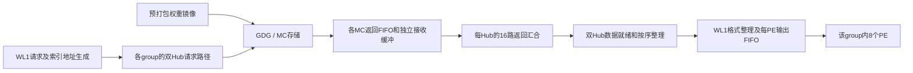

# M1 local/k4：从权重、激活准备到MAC和OL1的逐拍数据流

日期：2026-10-28。本文面向初次接触该硬件的读者，解释当前861-cycle案例的数据量、分工与流水。它是[持续吞吐排查](PE_SUSTAINED_THROUGHPUT_INVESTIGATION_20261028.md)的跟进说明。

**结论先行：一次全阵列有效计算需要16 KiB权重，上游条件接口容量为8 KiB/PE周期，所以理想需要两拍准备一份计算片段；随后64个PE可以并行接受它。AL1提供激活，MAC产生乘积，OL1保存并累加部分和。两拍供数、七拍局部计算延迟可以重叠，不能逐片段相加。实测861是完整N512命令的稳态完成间隔，不是其中某一层的固定流水延迟。**

## 1. 本文分析哪一个测试，哪些数字可以确定

对象是单核的一条完整PE命令：

```text
A：[1,4096]，BF16，8 KiB
W：[512,4096]，BF16，4 MiB有效权重
Y = A × Wᵀ：[1,512]，数学输出512个数
布局：局部V-cache/page128
计算映射：KC，MTW=1、MTC=32、MTK=4，UEN=0
```

这是之前lm_head实验的完整块，不是当前打开的GDN文件中每次pe_dot的实际shape。完整lm_head测试是N=8448、双核，各核4224输出，通常为8条N512完整块和1条N128尾块。这里分析其中一条N512命令，不将双核相加。

| 数字的类别 | 本文含义 |
|---|---|
| 确定的工作量/映射 | 从测试shape、权重文件和当前RTL得到，可逐项核算 |
| 条件逐拍时序 | 假设接口持续ready、数据按期返回、无反压；不是实际波形 |
| 已有实测 | trace中的稳态完成间隔861等；不是内部valid/stall计数 |
| 尚未闭合 | 实际MC返回延迟、不同域时钟/排队、内部等待分配 |

当前本地RTL尚未证明与远端冻结simv逐文件相同，因此局部RTL逐拍结论保留版本边界。本文没有运行新的VCS，也没有获得内部wave。

## 2. 先认识硬件：8个group、64个PE和8192个乘法lane

把硬件想成8个车间，每个车间8台机器，每台机器16个计算单元，每个计算单元一次处理8对数：

```text
一个core
 ├─ group 0：PE0～PE7
 ├─ group 1：PE0～PE7
 ……
 └─ group 7：PE0～PE7

每个PE：16个ALU
每个ALU：8个BF16乘法lane + 加法树 + OL1部分和路径
```

```text
全核乘法lane数 = 8 group × 8 PE × 16 ALU × 8 lane = 8192
```

MAC是Multiply-Accumulate（乘加）的缩写，例如不断累加`A[k]×W[n,k]`。本RTL中乘法、加法树、FP32部分和累加分布在不同流水级；说8192 MAC/cycle是等效峰值工作量口径，不表示每个物理乘法模块都是一拍完成的原生FMA。

必须区分：**MTK=4的四个逻辑输出组G0～G3，不是硬件的八个PE group。** 四个逻辑输出组轮流使用同一套八个硬件group。

## 3. 一份工作怎样分给64个PE

把输出512分成4组，每组128；把K4096分成64轮，每轮64：

```text
逻辑输出组 g=0..3，每组128个输出
归约轮     c=0..63，每轮64个K位置
片段编号   q=4c+g，共256个片段

片段q计算：A[64c:64c+64] × W[128g:128g+128,64c:64c+64]ᵀ
```

计算顺序为`G0/C0 → G1/C0 → G2/C0 → G3/C0 → G0/C1 → …`。

硬件group编号h=0..7，组内PE编号p=0..7，ALU编号a=0..15，lane编号l=0..7，则该lane处理：

```text
输出下标 n = 128g + 16h + a
归约下标 k = 64c + 8p + l
乘积       = A[k] × W[n,k]
```

以G0/C0为例：

| 硬件 | 本片段处理的内容 |
|---|---|
| group0 | 输出0～15，各自对K0～63贡献部分和 |
| group1 | 输出16～31，各自对K0～63贡献部分和 |
| group7 | 输出112～127，各自对K0～63贡献部分和 |
| 任一group的PE0 | 该group的16个输出，处理K0～7 |
| 任一group的PE1 | 相同16个输出，处理K8～15 |
| 任一group的PE7 | 相同16个输出，处理K56～63 |
| PE内ALU a | 对应一个输出通道，处理8个乘积 |

例如group0/PE0/ALU0处理`A[0:8]`与`W[0,0:8]`；ALU1仍用同一份`A[0:8]`，但权重是`W[1,0:8]`。group0/PE1/ALU0改为处理`A[8:16]`与`W[0,8:16]`。

所以8个PE不是把同一份计算重复8次，而是分担K方向的不同部分。每个PE的OL1先维护自己的局部部分和，随后还要进行PE之间的结果归约；本文不改变硬件已有归约次序。

## 4. 权重在哪里，怎样进入WL1

当前回放包的权重文件先被仿真初始化加载到对应核心/硬件group的权重地址空间。运行时，WL1发请求，从GDG/MC读取权重。这不是先执行普通LD把整块4 MiB权重搬到AL1或L2，再由PE读取。



这是每个硬件group各有的路径，不是一条窄总线依次服务group0、group1、……、group7。按当前双Hub配置，每个group连接两个Hub，每个Hub从16个MC通路取得数据。

### 4.1 每拍能回来多少

下表中的“每拍”均指接口在相关时钟/握手条件下能持续提供的条件容量。MC物理服务、CDC和排队是否支持它，不能仅靠位宽保证。

| 范围 | 一次返回/接受的数据量 | 两次后累计 |
|---|---:|---:|
| 一个MC通路 | 32 B | 64 B |
| 一个Hub，16条MC通路齐备 | 16×32=512 B | 1024 B |
| 一个硬件group，两个Hub齐备 | 2×512=1024 B | 2048 B |
| 全核8个group同时齐备 | 8×1024=8192 B | 16384 B |

一个片段需要`128×64×2=16384 B`权重。因此每个group两份1 KiB双Hub包，才能凑出它负责的2 KiB权重；全核同时得到16 KiB。

**8 KiB/拍是上游返回容量；16 KiB/次是全阵列一次有效计算需要的操作数。两者不是同一个端口，也不能写成WL1每拍必定向MAC输出16 KiB。** 输出缓冲可能短时攒够连续批次，但不能突破长期上游供数约束。

### 4.2 两份包怎样分到8个PE

本片段每个PE需要：

```text
16个ALU × 每ALU 8个权重 × BF16的2 B = 256 B
8个PE × 256 B = 2048 B/group
```

WL1先按当前布局整理两份返回包，再给8个PE各自对应的256 B。每PE输出FIFO宽2048 bit、深2，即512 B/PE；它只存约两份这样的操作数，不存整块4 MiB权重。

当各PE都ready时，可以并行分发，不是每拍只给一个PE而轮询8拍。若某个PE暂时不接收，已返回数据可以先进入有限缓冲；缓冲满后会把反压逐级传回Hub和GDG。具体哪一级实际满过，需要动态计数，不能由“有FIFO”直接断定瓶颈。

### 4.3 权重地址顺序

局部布局中，片段q在镜像中占连续16 KiB；group h对应其中的2 KiB。values起址为B时，元素字节偏移为：

```text
B + (4c+g)×16384 + h×2048 + (8p+l)×32 + a×2
```

它描述镜像中的排列，各group有各自的存储通路，并非所有请求共用一个串行地址端口。索引先确定物理页，随后页内按地址生成器推进；当前page128案例不要求每个片段都重新远端读取一次索引。

## 5. 激活怎样从L2进入AL1，再送到MAC

激活是另一条供数链：

```text
输入A → LD → L2/LB
              ↓ PEC读取与数据拆分
         8份128-bit激活切片，分别对应PE0～PE7
              ↓ 同一组切片广播到8个硬件group
         每个PE自己的AL1 ping/pong SRAM
              ↓ AL1读出128 bit
         同一PE的16个ALU共享这份激活
```

当前PEC的L2/LB返回数据接口为1024 bit，即128 B，刚好容纳64个BF16。KC映射下，一份A的K64切片拆成8份，每份8个BF16、16 B，分别对应p=0..7。PEC中相同p的激活数据连接到多个group：各group计算不同输出，但需要相同的A。

例如C0：PE0获得A[0:8]、PE1获得A[8:16]，直到PE7获得A[56:64]；这套分配对八个group重复。**这里的广播提供跨输出通道的激活复用，不是权重复用。**

### 5.1 AL1的容量和装载次数

每个PE的AL1有两个bank：每bank为128 bit×64=1 KiB，ping/pong合计2 KiB。MTC=32对应一个C分块覆盖K2048：

```text
每个PE负责其中2048/8=256个BF16 = 512 B = 32个AL1字
完整K4096中，每个PE对应512个BF16 = 1024 B
同一份A按group复制存放，不是每个PE都保存完整8 KiB的A
```

这些是该映射的必要数据量，不等于已经测出真实装载拍次。假设对齐、无重复读取且接口每拍成功返回128 B，K2048需要32份L2数据，完整K4096需要64份；这是唯一输入数据对应的理想传输计数。真实PEC还受命令循环、`flag_only`、ping/pong、共享接口及握手影响，不能直接宣称“激活初始化恰好64拍”。

`flag_only`允许满足条件后只推进控制、保留AL1内容，避免再次读取L2；它不表示跨所有后续PE命令永久驻留。装载通常可与其它阶段重叠，不能把64拍直接加在512拍权重时间之后。

### 5.2 一次有效计算时，激活如何复用

AL1每次给一个PE读出16 B。这16 B同时广播给该PE的16个ALU；各ALU权重不同。因此16 B激活支持128个乘积。

对同一C轮的G0、G1、G2、G3，使用相同的A切片，依次搭配四组不同权重。可以重复读AL1中的同一内容；“复用”不等于必须在ALU输入寄存器里一份数据保持四次而不再读AL1。

| 范围 | 一次有效接受的激活端口量 | 权重量 | 乘积数 |
|---|---:|---:|---:|
| ALU | 16 B | 16 B | 8 |
| PE | 16 B，共享给16 ALU | 256 B | 128 |
| group | 8 PE合计128 B | 2048 B | 1024 |
| core | 64 PE合计1024 B | 16384 B | 8192 |

全核1024 B激活是端口求和；本片段唯一的A只有128 B，广播至8个group。它更不是每次MAC接受都要从L2读取1024 B。

## 6. 一份片段的理想逐拍旅程

这里必须设两个时间原点：T0是首份values请求被接受；E0是某片段已供齐并被MAC接受。两者之间包括MC/CDC/汇合/格式整理及激活等待，当前没有唯一实测值。

### 6.1 请求、返回、整理流水

令L为请求到对应双Hub包齐备的固定延迟，F为之后整理/输出至MAC的公共延迟。假设连续返回、索引已就绪、AL1及MAC/OL1均ready，令S=L+F+1：

| 片段 | 两次values请求，相对T0 | 理想MAC接受，相对T0 | 使用的A |
|---|---:|---:|---|
| G0/C0 | 0、1 | S | A[0:64] |
| G1/C0 | 2、3 | S+2 | A[0:64] |
| G2/C0 | 4、5 | S+4 | A[0:64] |
| G3/C0 | 6、7 | S+6 | A[0:64] |
| G0/C1 | 8、9 | S+8 | A[64:128] |
| G3/C31 | 254、255 | S+254 | A[1984:2048] |
| C32切换 | 256无values请求 | 前面片段可继续流动 | ping/pong与控制按就绪推进 |
| G0/C32 | 257、258 | S+257 | A[2048:2112] |
| G3/C63 | 511、512 | S+511 | A[4032:4096] |

为什么G3晚6拍不是额外等待？它本来就排在第四个片段，每片段两份包。只要按这个相位持续到达，整条流水仍达到条件带宽。请求生成不要求等前一个片段OL1完成才请求下一个片段。

512个values请求在c32内部边界多一个空拍，跨度513拍。**这不包含初始索引、初装、公共延迟S和输出收尾，不是完整指令必然513拍。**

### 6.2 MAC到OL1的局部逐沿时间

以下沿用当前本地RTL、BF16、UEN=0、所有ready持续有效的条件推导，E0为输入操作数握手沿：

| 上升沿 | 动作 | 小白理解 |
|---|---|---|
| E0 | MAC第一级接受激活和权重 | 把本次8对数送进运算流水 |
| E1 | MAC第二级 | 乘法路径继续推进 |
| E2 | 加法树寄存阶段 | 汇合该ALU的8个乘积 |
| E3 | 归一化寄存阶段 | 整理数值表示；UEN=0跳过额外scaling计算 |
| E4 | OL1 FP32累加第一级 | 当前贡献与该链旧部分和进入求和流水 |
| E5 | OL1 FP32累加第二级 | 继续求和 |
| E6 | OL1 FP32累加第三级 | 沿后结果和控制可用 |
| E7 | 写回OL1 buffer | 本轮局部部分和更新完成 |
| E8 | 若已完成当前bank，首结果读入输出寄存器 | 准备交出局部结果 |
| E9 | 下游最早接受首个OL1输出 | 结果离开该ALU的OL1接口 |

E0到E7是7个沿间周期；E8/E9仅适用于结果已完成且允许输出的场景，普通中间片段不输出完整K4096结果。k4一个ALU维护四个输出，最后片段在E0接受且bank可立即输出时，四个结果最早在E9～E12被接收。

这张表只到局部OL1，不包括组内8 PE结果归约、返回链、L2写回、VP或ST。也不意味着“从GDG请求到最终输出只要9拍”。

## 7. 为什么七拍计算延迟不应乘以256，四条链怎样交错

流水像多工位生产线：前一件进入第二工位时，后一件可进入第一工位。某件产品要七拍到OL1，不妨碍新片段每两拍进入一次。

以G0/C0的MAC接受为拍0，理想接受安排为：

```text
拍0：G0/C0进入MAC
拍2：G1/C0进入MAC；G0/C0已在后续流水
拍4：G2/C0进入MAC
拍6：G3/C0进入MAC
拍7：G0/C0局部部分和写回OL1
拍8：G0/C1进入MAC，后续才到达OL1累加入口
拍10：G1/C1进入MAC
……
```

每个ALU内部，同一g的两次更新相隔8拍；本地OL1普通旧和反馈约4拍，四链因此能覆盖这项局部反馈延迟。反馈约4拍与端到端写回7拍不同：反馈闭环从OL1累加入口算起，不包含前面的MAC/加法树流水。

MTK=4不会把M1变成真正的M4：M1四链使用四份不同输出权重，M4跨四行则可复用同一份权重。因此前者即使隐藏普通反馈，仍有权重带宽限制。

## 8. 总工作量、理想下界和861分别怎么计算

### 8.1 工作量守恒

```text
256片段 × 8192个乘积 = 2,097,152个乘积/等效MAC
按乘加2 FLOPs计：4,194,304 FLOPs

256片段 × 16 KiB = 4 MiB权重
每group：512 KiB权重
每PE：64 KiB权重，流式经过，并非一次驻留

每PE：256次AL1读 × 16 B = 4 KiB本地读工作量
全核AL1端口读工作量：256 KiB
唯一A数据仍仅8 KiB：包含8 group复制以及四输出组重复使用
```

### 8.2 条件下界

```text
纯算术吞吐下界 = 2,097,152 / 8192 = 256 cycles
权重接口容量下界 = 4,194,304 B / 8192 B/cycle = 512 cycles
理想重叠的主项下界 = max(256,512) = 512 cycles
```

c32请求发生器还有一个内部边界空拍；初装、索引、填充与排空另有成本。不能写成“512+256=768”，也不能写成“每片段两拍传输+七拍计算，共256×9”。

### 8.3 实测861的含义和边界

861是同核相邻完整N512命令的完成间隔。它不是每条指令从最初排队到完成的生命周期，也不是已测得MAC忙了861拍。

```text
算术工作量折算利用率 = 256/861 = 29.73%
有效权重工作吞吐 = 4 MiB/861 ≈ 4871 B/cycle
相对条件8 KiB/cycle容量 = 512/861 ≈ 59.47%
```

这些是工作量除以端到端时间，不是MAC active或WL1 valid的实测占空比。

已有匹配路径的经验模型为`T≈48+203×权重MiB+内部C边界数`，因此N512/c32为`48+203×4+1=861`。其持续项相当于每片段3.171875拍，而非理想2拍；**这是端到端增量折算，不是观察到每个片段固定3.17拍。48也不是已测出的装载延迟。**

## 9. 哪些地方可能让理想时间表停下来

| 位置 | 停顿条件 | 对后续的影响 |
|---|---|---|
| GDG请求接收 | 在途额度满、请求队列或仲裁未就绪 | 后续权重未及时发出 |
| MC服务/返回 | 时序、时钟比、服务间隔、返回FIFO压力 | 返回不能维持每拍一份 |
| 16路MC汇合 | 有一路未到 | 已到数据先缓冲，缓冲满再反压 |
| 双Hub汇合 | 另一半未到或按序条件不满足 | 无法形成完整双Hub包 |
| WL1输出 | 某PE未接收、输出FIFO满 | 反压传至返回链 |
| AL1 | 数据/控制未就绪，bank尚不能使用 | 权重已有也不能开始配对计算 |
| MAC/OL1 | 普通旧和未就绪、输出/bank切换阻塞 | 流水ready下降并可能反压WL1 |

GDG的15是每条相关读链的在途笔数门限，不是15 cycles。额度在GDG返回数据被其下游接收时释放，不必等MAC/OL1算完；但下游缓冲填满可间接延迟释放。因此“权重总地址连续”和“普通四链反馈可覆盖”，都不等于所有其它门控始终开放。

当前已能静态说明局部快路径允许接近两拍一片段，并用实验确认主要持续成本随权重工作量增长；尚未把861唯一分解成MC、汇合、激活或OL1反压各多少拍。正在进行的有效PE隔离与工作集对照负责继续区分它们，不能把本文理想表当作实际完整波形。

## 10. 代码和可复核依据

| 项目 | 源码/已有报告 |
|---|---|
| 片段映射、实际元素偏移、完整请求公式 | [静态请求时序报告](PE_LOCAL_K4_STATIC_REQUEST_TIMELINE_20261028.md) |
| 权重请求与K/V寻址 | [wl1_518_weight_ctrl.v](../../rtl/zeus518/wl1/wl1_518_weight_ctrl.v) |
| Hub的MC请求与返回 | [hub_mc_req_ctrl.v](../../rtl/zeus518/wl1/wl1_518_hub_mc_req_ctrl.v) |
| 权重整理与每PE FIFO | [weight_data_format.v](../../rtl/zeus518/wl1/wl1_518_weight_data_format.v) |
| 8 PE分发控制 | [req_distribute_fsm.v](../../rtl/zeus518/wl1/wl1_518_req_distribute_fsm.v) |
| PEC激活拆分、group广播及flag_only | [pe_ctrl_logic.v](../../rtl/zeus518/pe_ctrl/pe_ctrl_logic.v)，数据广播连接约4175行起 |
| 每PE AL1容量、读出与握手 | [pe518_al1.v](../../rtl/zeus518/pegroup/pe518_al1.v) |
| PE中16 ALU的激活共享、权重切片 | [pe518_top.v](../../rtl/zeus518/pegroup/pe518_top.v)，约202行起 |
| ALU的8 lane | [pe518_alu.v](../../rtl/zeus518/pegroup/pe518_alu.v) |
| 局部流水控制 | [pe518_alu_ctrl.v](../../rtl/zeus518/pegroup/pe518_alu_ctrl.v)、[OL1控制](../../rtl/zeus518/pegroup/pe518_ol1_ctrl.v) |
| 861经验模型、局部E0～E12推导及窗口边界 | [861联合分析](PE_M1_861_CAUSAL_ANALYSIS_20261028.md)，第3、4、9、10节 |
| 真实返回链计数testbench与隔离任务 | [当前执行记录](PE_CAUSAL_DIAGNOSTICS_EXECUTION_20261028.md) |

复核方式：对照上述RTL端口宽度/连接与已有静态枚举，交叉核算各层字节数和乘积数；未为说明文档重新运行完整硬件仿真。本文为跟进解释，不修改RTL、编译器或kernel。


## 2026-10-29：PE ready恒真的本地RTL返回链复测

已重新编译并完成7组测试。默认理想MC服务下256批权重首末接收跨度512拍，首请求至末接收527拍，无请求/格式化/Hub反压；该测试不含实际AL1/MAC/OL1。延长人工MC延迟会触发真实15笔额度门限，慢路会引起汇合反压。详见[完整计数、范围及复现方法](PE_READY_ALWAYS_RTL_RESULTS_20261029.md)。这些是局部模型结果，不能直接作为远端861的根因证明。


## 2026-10-29：已接入真实AL1/MAC/OL1

后续已完成单PE与GDG/Hub/WL1＋8个真实PE的联动仿真，数值通过。理想供数下MAC接收跨度512拍，计算窗口内没有激活/命令/流水反压，最后MAC后9～12拍输出四组OL1结果。详见[真实计算端逐周期仿真报告](PE_REAL_COMPUTE_RTL_RESULTS_20261029.md)。该结果仍限定预装激活、输出恒ready及人工MC服务边界，不等同于远端861复现。


## 2026-10-29：连续命令与真实归约/输出控制

已进一步完成三条命令按真实FIFO和激活消费额度推进、8PE真实归约及FP32输出控制的仿真。理想两拍供数时两次相邻group完成间隔均517拍，下一条MAC早于上一条输出完成；数值通过并经第二仿真器核验。详见[连续指令逐拍结果及模型边界](PE_CONTINUOUS_GROUP_RTL_RESULTS_20261029.md)。此连续模型的权重源仍为理想测试源，不能将517直接等同于完整MC/PEC路径的生产周期。


## 2026-10-29：PEC与L2接入后的本地结果

已接真实PEC、L2、group入口FIFO与输出credit，保留理想两拍权重供给。三条M1/N512/K4096命令数值及1536个L2回读值全部通过，两次PEC完成间隔均为515拍；各条MAC窗口严格每两拍接收一次。模型为同钟、无其他L2竞争的两类group对称代表，不是远端861复现。详见[PEC＋L2逐周期报告及边界](PE_PEC_L2_RTL_RESULTS_20261029.md)。


## 2026-10-29：已接入真实权重返回链

保留PEC/L2与1536个FP32回读校验，接入真实GDG/Hub/WL1返回模块。低延迟MC模型下连续完成间隔529拍，后两条MAC窗口512拍；LAT14/23对照为640/955拍，返回空洞对应传播到MAC，三组数值及额度计数均通过。MC服务及WL1请求/指令调度仍为测试模型，不是远端861复现。详见[返回链联动仿真报告](PE_PEC_L2_RETURN_CHAIN_RESULTS_20261029.md)。
