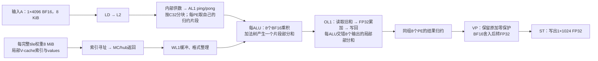

# PE 算力、供数带宽与 Roofline：RTL 容量推导及 M1/M2/M4 实测分析

日期：2026-10-22。分析对象：Zeus518 稠密 BF16 点积路径。约束：不修改 RTL；通过现有 ISA、编译器和 kernel 寻找优化空间。本报告整合硬件独立容量图、当前算子实测、启动及收尾开销分析。

## 1. 结论与证据边界

1. 本地 RTL 的并行结构对应单核 **8192 个 BF16 乘法 lane**，按点积一次乘加计 2 FLOPs，算术容量为 **16384 FLOPs/cycle**；400 MHz 时为 **6.5536 TFLOPS**。
2. 按 8 个 group、每组两个 4096-bit hub、各 hub 每 PE 周期完整返回一拍的假设，MC→WL1 聚合接口容量为 **8192 B/cycle，即 3.2768 TB/s**。这是接口容量，不是已经测得的 MC 持续带宽。
3. 不绑定 kernel 的权重接口条件 Roofline 为 `P ≤ min(6.5536, 3.2768×Iw) TFLOPS`，转折点为 **2 FLOP/B**。它只描述权重接口这一层，不是包含激活、输出及全部访存层级的完整实测 Roofline。
4. 对每核完整 N512/K4096 块，M1 的纯算术下界为 **256 cycles**，理想权重供数下界为 **512 cycles**。充分重叠时取两者最大值，不能相加；512 也不是已证明软件可达的性能。
5. 实测 M1/M2/M4 的代表性稳态完成间隔为 **1015／1022／1177 cycles**。M1→M2 算术量翻倍、时间只增 0.69%，证明原执行过程中存在可由更多真实输入行摊薄的成本，支持 M1 并非由纯算术峰值主导。
6. M4 的算术容量比已达约 **87.0%**。M4 完整块自动选择 c16，而 M1/M2 为 c32，不能将全部变化归因于单一计算量因素。
7. 全算子每行吞吐相对 M1 提升约 **1.943×／3.341×**，前提是业务允许真实多行合并。这组多行对照不是单行 M1 延迟下降，也没有定位出一个能把 1015 降到 512 的软件修改。后续单行优化已在第15节实测降至861 cycles。

报告区分三种证据：**RTL 静态容量**、**VCS 实测时间与正确性**、**基于这些数据的推断**。没有内部 active/stall、MC 字节、credit 或 wave 数据，因此不将 FIFO、慢响应汇合或 MC 带宽列为已证实瓶颈。

**后续定向推导更新：**第13节新增OL1累加反馈控制模型。由三级FP32累加流水及寄存credit推导出的M1窗口分别为N128=256、N512=1015、N1024=2027，与已有结果一致，无拟合等待参数。因而“差距只能靠内部采样定位”不再准确；现已有很强的累加反馈结构性解释。下文第10、11节保留此前容量分析的边界，不应再把权重供给不足作为默认解释。模型仍非完整RTL/封存simv验证，M2/M4残差尚未全部解释。

**2026-10-27实测更新：**第14节补充相同normal权重布局、同数据的M1 MTK1/2/4受控VCS。三组输出均逐位通过；k1复现1015-cycle稳态，k2/k4均退化为4864 cycles，全局9425→40203 cycles。增加独立输出累加链没有带来净收益，表明必须同时考虑MTK改变的权重访问和执行控制成本。该结果既不能证明k1完全由带宽限制，也不能把第13节OL1局部模型直接推广成所有MTK的性能预测。

**2026-10-27联合布局实测更新：**第15节三组局部V-cache均VCS逐位PASS；k1/k2/k4稳态1051/897/861 cycles。最佳k4较normal/k1稳态缩短15.17%，全局9425→8219 cycles，缩短12.80%。第14节的负结果仅适用于固定normal布局；新证据已确认布局与MTK联合调整有单行收益，未证明剩余瓶颈的唯一来源。

**2026-10-27五候选完成更新：**第19节A～E全部VCS逐位PASS。A（N1024局部V-cache/k8/c32/page128）稳态1673，折合每512输出836.5，全局8021，较此前最快8211缩短2.314%。B无收益；page256/512及N512名义k8均与c32的861/8219相同。

## 2. 分析口径

| 项目 | 本报告口径 |
|---|---|
| 数值模式 | 稠密 BF16 激活 × BF16 权重；不外推 FP8、INT8、INT4 或稀疏模式 |
| 算术计数 | 一次点积乘加按 2 FLOPs；MAC 为等效吞吐单位，不表示每个物理乘法实例自身是原生 FMA |
| 计算规模 | 硬件图按单核；算子实测另外列出双核全局耗时 |
| 时钟 | 实测 trace 400 MHz，1 cycle = 2.5 ns；RTL 容量换算采用相同运行点 |
| 流量单位 | 1 MiB = 2²⁰ B；TB/s 与 TFLOPS 使用十进制 10¹² |
| 稳态时间 | 同核相邻完整 N512 PE 指令的完成时间差 |
| 全局时间 | 物理对齐后的最早 first_accept → 最晚 task_done |
| 数值合同 | 保留原 golden 和严格逐位比较，不以改变归约顺序换取未验证收益 |

“一条 PE 命令的生命周期”“相邻命令的完成间隔”“MAC 实际工作周期”不同。命令可在队列中等待，生命周期会重叠；不能把各指令 duration 相加当作总时间，也不能把完成间隔直接当作 active 周期。

## 3. 数据在哪里，计算发生在哪里

### 3.1 激活与权重路径


计算发生在 ALU 内部的 MAC 乘法路径及后续加法树、累加路径。AL1/WL1 负责保存和供应操作数，不是运算阵列。

激活通过 LD 到 L2 后，仍需内部供数路径将片段送到 AL1；“LD 一次”不等于完整输入永远驻留在每个 ALU。权重按片段流式经过 MC、WL1 格式整理和 FIFO，再进入 PE。也不是先将整块 4 MiB 权重放入 ALU 后才开始计算。

MAC 只有握手成功时才锁存操作数的解码结果进入流水寄存器，接受条件为：

```text
weight_valid && activation_valid && command_ready && pipeline_ready
```

对应 [pe518_alu_ctrl.v:159](references/code/rtl/zeus518/pegroup/pe518_alu_ctrl.v#L159) 与 [pe518_mac.v:585](references/code/rtl/zeus518/pegroup/pe518_mac.v#L585)。有数据连线并不代表每拍都接受数据。

### 3.2 一拍能接受多少、计算多少

一个 ALU 的激活和权重输入各 128 bit，分别包含 8 个 BF16。8 个 lane 并行处理 `a[0]×w[0] … a[7]×w[7]`，产生 8 个乘积，再通过加法树处理。这里描述每次有效接受的数据量；结果存在流水延迟，不是一拍完成完整 K4096。

一个 PE 包含 16 个 ALU。**同一份 128-bit 激活广播到 16 个 ALU；权重为各 ALU 分配不同的 128-bit 片段。** 对应 [pe518_top.v:202](references/code/rtl/zeus518/pegroup/pe518_top.v#L202) 与 [pe518_alu.v:82](references/code/rtl/zeus518/pegroup/pe518_alu.v#L82)。

| 范围 | 激活输入 | 权重输入 | 每次有效接受的 BF16 乘积数 |
|---|---:|---:|---:|
| 1 ALU | 16 B，8 个元素 | 16 B，8 个元素 | 8 |
| 1 PE，16 ALU | **16 B，广播共享** | 256 B，128 个元素 | 128 |
| 1 group，8 PE | 各 PE 分别供给，端口合计 128 B | 2048 B | 1024 |
| 1 core，8 group | 各 PE 分别供给，端口合计 1024 B | 16384 B | 8192 |

表中 group/core 的激活数字是端口汇总，不是唯一输入字节数，更不是 L2 每周期必须读取的字节数；不同实例可能复用数据。后三列都以相关单元同时有效接受为前提。

### 3.3 缓冲容量与 tile 大小不同

每个 PE 的 AL1 有两个 128-bit×64 的 ping/pong SRAM，合计 **2 KiB/PE**，支持分片装载和使用，不能据此声称完整 K4096 激活在每个 PE 中全部驻留。

WL1 输出侧为每 PE 一个 **2048-bit×2 深度 FIFO**，即 512 B/PE、4 KiB/group；这是已核查的输出 FIFO，不是全部 WL1 缓冲总容量。[weight_data_format.v:1035](references/code/rtl/zeus518/wl1/wl1_518_weight_data_format.v#L1035) 给出其参数。

N512/N1024 是计算指令处理的输出规模，不表示 MAC 缓存装得下整块权重。已经验证 N1024，也不能由此推导存在一个 8 MiB 的 ALU 权重缓存。

### 3.4 OL1：部分和保存、FP32累加与反压

OL1是每个ALU的局部部分和存储及累加路径，与保存激活的AL1、供应权重的WL1作用不同。BF16模式下，每个ALU有ping/pong两组各16×32-bit寄存器缓冲，合计128 B/ALU；这是部分和存储，不是输入或权重缓存。见[pe518_ol1_buffer.v](references/code/rtl/zeus518/pegroup/pe518_ol1_buffer.v)。

对同一输出的归约可概念性表示为：

```text
第0轮：当前片段部分和 → 不使用旧累加值 → 经过流水写入OL1
第1轮：读取OL1旧和 + 当前片段部分和 → 三级FP32流水 → 写回OL1
后续轮：重复读旧和、加新片段、写回；直到该输出的归约结束
```

这里是控制和数据流说明，不将硬件的加法树/归约顺序替换成软件自行重排的归约。`pe518_ol1_ctrl`中的控制流水与`fp32_sum(PIPES=3)`中的运算流水对齐，**不是两段三级流水串联成六级**。控制条件见[pe518_ol1_ctrl.v](references/code/rtl/zeus518/pegroup/pe518_ol1_ctrl.v)，运算实例见[pe518_ol1.v](references/code/rtl/zeus518/pegroup/pe518_ol1.v)。

后续累加必须取得旧部分和。`avlb_mtc_cnt`记录可用项，读旧和消耗一项，写回增加一项，ping/pong切换时按控制清理。它是寄存状态，因此旧和从三级流水写回后，下一拍才可再次用于依赖累加。单条链的理想接受节奏约为`0,4,8,12,...`，详见第13节。即使输入激活与权重均充足，旧和不就绪也会降低OL1入口ready，再通过流水向MAC和WL1传播反压。

多个独立输出可以交错使用这段流水：在所查k1排程下，M1/M2/M4分别提供约1/2/4条独立行累加链。不同ALU虽然有各自输出，但每个ALU内部仍需有足够独立链才能隐藏自身反馈延迟；单纯增加ALU数量或再排一条PE命令不会自动消除它。

部分和完成相应归约后，OL1输出经group内PE结果归约和结果返回路径，才交给外部VP/ST。ping/pong和流水允许阶段重叠，但不能让同一条依赖链跳过尚未完成的旧和写回。第13节给出由此推导的局部模型；目前尚未通过冻结simv内部信号逐拍确认。

## 4. 不依赖 kernel 的算力与接口容量

### 4.1 算术峰值

```text
单核 BF16 lane 数 = 8 group × 8 PE × 16 ALU × 8 lane = 8192
点积等效 FLOPs/cycle = 8192 × 2 = 16384
单核峰值 = 16384 × 400,000,000 = 6.5536 TFLOPS
```

| 层级 | BF16 MAC 等效/cycle | 点积 FLOPs/cycle | 400 MHz 下峰值 |
|---|---:|---:|---:|
| ALU | 8 | 16 | 6.4 GFLOPS |
| PE | 128 | 256 | 102.4 GFLOPS |
| group | 1024 | 2048 | 819.2 GFLOPS |
| core | 8192 | 16384 | 6.5536 TFLOPS |
| 双核算术容量之和 | 16384 | 32768 | 13.1072 TFLOPS |

双核行只是算术容量加和，不保证共享存储或输出路径也线性扩展。上述峰值要求所有 lane 每拍接受有效操作数；未证明当前 workload 达到此条件。

### 4.2 MC→WL1 接口容量

每个 hub 汇集 16 路 256-bit 响应，输出宽度 4096 bit，即 **512 B**。normal 双 hub 情况下，每 group 聚合一拍为 **1024 B**。若 8 个 group 都能在每个 PE 周期获得一个完整双 hub beat：

```text
接口容量 = 8 × 2 × 512 = 8192 B/cycle
400 MHz 换算 = 3.2768 TB/s/core
```

关键前提是“每周期完整返回”，不是端口宽度本身自动保证。RTL 中 hub 的完整响应有效由 16 路 `dvld` 的 AND 产生；WL1 输出也有多个 FIFO 的有效汇合。这证明存在汇合条件，**不证明慢响应实际造成了多少等待**。见 [hub_weight_req_distribute.v:80](references/code/rtl/zeus518/wl1/wl1_518_hub_weight_req_distribute.v#L80)。

### 4.3 为什么供数容量只有满算权重消耗的一半

对 BF16 权重不重复使用的流式计算：

- MAC 输入侧单核每个满算接受拍消费 8192 个权重，即 **16 KiB**。
- 上游上述接口每周期理想提供 **8 KiB**。

所以即使 ALU 本身支持每拍满算，上游不复用权重时也只能平均支撑约一半的满算拍。FIFO 能平滑返回、支持短暂连续计算，但不能改变长期供给量。

当同一份权重参与多个真实输入行计算时，权重可在局部重复使用。RTL 的 MTW 计数控制 FIFO 在重放完成后才 pop，提供了复用机制；见 [weight_data_format.v:1131](references/code/rtl/zeus518/wl1/wl1_518_weight_data_format.v#L1131)。但该机制存在不等于此次已经测量了 MC 实际只取一次，也不保证其它路径没有新增成本。

## 5. 不参考当前 kernel 的 Roofline


[SVG](artifacts/pe_roofline_20261021/pe_hardware_roofline.svg) · [PDF](artifacts/pe_roofline_20261021/pe_hardware_roofline.pdf) · [容量数据](artifacts/pe_roofline_20261021/hardware_capacity.json)

### 5.1 定义与转折点

对于选定的 MC→WL1 权重边界：

```text
Iw = 有效计算 FLOPs / 实际通过该边界的权重字节数
P_cap(Iw) = min(P_peak, B_interface × Iw)
           = min(6.5536, 3.2768 × Iw) TFLOPS
Iw* = P_peak / B_interface = 2 FLOP/B
```

实际字节数应包含重复读取和传输填充，不能仅用逻辑张量大小替代。横轴虽然与某一个 kernel 无关，但仍是工作负载在所选边界上的属性；不指定工作负载，就没有可标注的实际运行点。

| 条件区间 | 谁先形成这个模型的容量限制 | 对优化方向的含义 |
|---|---|---|
| Iw < 2 | 权重接口容量 | 提高权重复用或持续供数能力，才能抬高该段容量上限 |
| Iw = 2 | 两项容量平衡 | 需要算术、供数及其它路径都能持续工作 |
| Iw > 2 | 算术峰值 | 在供给和输出足够的前提下，继续增加权重复用不再提高算术上限 |

这是容量分类，不是实际瓶颈诊断。如果实际点落在曲线下方，单凭位置无法区分供数气泡、激活等待、流水反压和控制开销。

### 5.2 完整硬件 Roofline 还缺什么

完整模型要对每个资源边界定义相应流量，约束共同成立：

```text
P ≤ min(P_peak,
        B_weight × I_weight,
        B_activation × I_activation,
        B_output × I_output,
        其它共享存储边界的 B × I)
```

各个 I 必须对应各自边界的字节数，不能用同一个只计权重的 Iw 直接乘所有带宽。更细的执行/指令吞吐上限可以继续作为额外约束。

当前尚缺各层持续带宽标定、实际流量和内部等待计数。因此现有图准确的名称是 **“BF16 权重接口条件容量 Roofline”**，不是芯片完整实测性能规格。

如果真实可持续供给 `B_sustained < B_interface`，相应供数线会下降、转折点向右移。不能用当前 4 MiB÷1015 的端到端比值充当独立带宽测量，再用它解释同一个 1015；这会形成循环论证。

## 6. 映射到当前 N512/K4096：256 与 512 如何得到

单核一条完整输出块：`A[M,4096] × W[4096,512]`。BF16 权重逻辑大小：

```text
权重 = 512 × 4096 × 2 B = 4,194,304 B = 4 MiB
MAC 数 = M × 512 × 4096
FLOPs = 2 × M × 512 × 4096
纯算术下界 = FLOPs / 16384 = 256M cycles
权重单次传输容量下界 = 4,194,304 / 8192 = 512 cycles
```

8192 MAC/cycle 与 16384 FLOPs/cycle 是同一容量的两种计数方式。M1 使用 `2,097,152 MAC ÷ 8192` 或 `4,194,304 FLOPs ÷ 16384` 都得到 **256 cycles**，与将工作量再除以双核无关。

若每份权重通过边界一次并服务 M 行，名义 `Iw=M FLOP/B`：

| M | FLOPs/完整块 | 纯算术下界 | 权重接口下界 | 两者充分重叠的条件下界 |
|---|---:|---:|---:|---:|
| 1 | 4,194,304 | 256 | 512 | 512 |
| 2 | 8,388,608 | 512 | 512 | 512 |
| 4 | 16,777,216 | 1024 | 512 | 1024 |

充分重叠时取 `max(T_compute,T_supply)`。若实现无法充分重叠，实际可能更长；本表既不证明完全重叠，也不假定二者串行相加。启动、排空、其它数据路径均可能额外限制时间。

整算子 N8448 由双核各处理 4224 个输出，单核是 8 个 N512 块加 1 个 N128 尾块，权重 **33 MiB/core**。4 MiB 是一条完整 N512 块的权重总量，不是整核权重总量，也不是以 M 行数重复计算后的字节数。

## 7. 当前 VCS 数据与测量有效性

### 7.1 实验合同

| case | VCS Job ID | 远端 functional | VCS 输出项数 | 完整块选型 |
|---|---|---|---:|---|
| M1 基线 E12 | `b8502c46ecdb` | 使用已封存 E12 基线证据 | 8448 | w1/c32/k1 |
| M2 | `6dafa796b952` | `708770ebbcc3`，严格 PASS | 16896 | w2/c32/k1 |
| M4 | `4182cb8a1e2f` | `51d37f5c2310`，严格 PASS | 33792 | w4/c16/k1 |

固定 N8448/K4096、BLOCK_N512、双核预打包权重、冻结 E12 编译器与一块前看流水。M2/M4 使用 BLOCK_M=M，同时计算多个真实内存行，不是重复执行 M1，也不是只让一个有效行参与计算。

任务源副本为正确多行输出，将局部 store 行 stride 从 WIDTH 改为全局 N；修正后的 M1 重新编译代码段与 E12 相同。新增输入行取 E12 原行的 `[1,-1,2,-2]` 倍，golden 经原 E12 M1 逐行独立核验。该数值集合是受控诊断输入，不代替所有业务输入的广泛正确性覆盖。

M2/M4 平台 named-output 均 bit-exact，下载真实 VCS 输出后与原 golden 离线逐字节一致，未放宽比较阈值。mailbox 162 字段全部为零，双核 trace 完整。rtl_tag、simv、frozen RTL、server build、implementation、mapping 六项身份与 M1 匹配；MC 模式、400 MHz 及两核 LocalMem 权重地址一致。

需要保留的限制：

- 同一远端 simv 的 A/B 身份一致，不等于本地 RTL 已与封存 simv 逐文件对应。源码 SHA 校验确认本地引用文件自前次容量推导后未变化。
- M4 的 c32→c16 为实际代码生成变化，属于解释性能时的混杂因素。
- trace observer 合同为 draft，`metric_eligible=false`；这里使用同边界诊断对照，不宣称正式指标资格。
- 每个变体只有一次运行，暂无重复测量误差范围。
- host 权重预装均为 66 MiB，仅说明初始化内容相同，不是核内 MC 权重流量计数。

### 7.2 计时口径冲突

| case | 平台 meta.actual_cycles | 本报告采用的全局对齐周期 |
|---|---:|---:|
| M1 | 17015 | **9425** |
| M2 | 17312 | **9700** |
| M4 | 18895 | **11283** |

本报告使用 `trace_time_alignment.kernel` 中物理对齐的 observer 边界，不使用混入各核本地时间戳偏置的 metadata 数字或 profiler 估算器周期。稳态间隔在同核完成时间上计算，不受跨核时间原点影响。

## 8. 将 M1/M2/M4 实测放到容量图上


[SVG](artifacts/pe_roofline_20261022/pe_roofline_measured.svg) · [PDF](artifacts/pe_roofline_20261022/pe_roofline_measured.pdf) · [数据 JSON](artifacts/pe_roofline_20261022/data.json) · [CSV](artifacts/pe_roofline_20261022/points.csv)

图中横坐标使用名义单次取权重假设，即 M1/M2/M4 对应 Iw=1/2/4；纵坐标来自实际稳态完成间隔。**实际 MC 字节数尚未测量，所以横坐标不是已完成物理流量标定的实测值。**

| 指标，单核完整 N512/K4096 | M1 | M2 | M4 |
|---|---:|---:|---:|
| 完整块完成间隔，两核一致 | 7×1015 | 7×1022 | 1×1178、6×1177 |
| 代表性稳态间隔 | 1015 | 1022 | 1177 |
| 推导吞吐/TFLOPS | 1.65293 | 3.28321 | 5.70169 |
| 算术峰值容量比 | 25.22% | 50.10% | 87.00% |
| 条件 Roofline 容量比 | 50.44% | 50.10% | 87.00% |
| 稳态每行摊销周期 | 1015 | 511 | 294.25 |
| 稳态每行吞吐相对 M1 | 1× | 1.986× | 3.449× |

吞吐按 `完整块 FLOPs × 400 MHz / 稳态周期` 推导。算术峰值容量比为 `256M / 实测周期`，不是 active 信号测得的占空比；条件 Roofline 容量比为 `max(256M,512) / 实测周期`。

M1→M2 的总算术量增加 100%，稳态时间仅增加 **7 cycles，约 0.69%**。M4 算术量是 M1 的四倍，主要稳态时间只增加 **162 cycles，约 15.96%**。这支持“存在可被多行计算摊薄的供数/控制成本”，并显示更多计算利用了原先未充分使用的算术容量。

M4 相比纯算术容量下界 1024 仍多 153cycles，但不能将其直接叫作可删除 stall；同样，M1 的 `1015−256=759` 和 `1015−512=503` 不是隔离测得的内部等待时间。

## 9. 首条、稳态、尾块与固定开销

### 9.1 PE 跨度重建

| 项目 | M1 | M2 | M4 |
|---|---:|---:|---:|
| 首条 PE 生命周期 | 1125 | 1165 | 1314 |
| 首条生命周期减代表性稳态 | 110 | 143 | 137 |
| N128 尾块完成间隔 | 256 | 260 | 295 |
| 首 PE 开始至末 PE 完成 | 8486 | 8579 | 9849 |

```text
M1 PE跨度 = 1125 + 7×1015 + 256 = 8486
M2 PE跨度 = 1165 + 7×1022 + 260 = 8579
M4 PE跨度 = 1314 + 1178 + 6×1177 + 295 = 9849 
```

M2 跨度增加 93：首条 +40、七个完整块间隔合计 +49、尾块 +4。M4 增加 1363：首条 +189、完整块间隔合计 +1135、尾块 +39。增长不只是启动和收尾；M4 的稳态间隔本身也增长了。

110/143/137 可作为首条额外成本的观察值，但首条与后续指令的排队和流水状态不同，不能将其叫作独立测得的固定流水填充时间。

### 9.2 每核互不重叠的阶段

| case/core | first_accept→首 PE 开始 | PE 跨度 | 末 PE 完成→task_done | 单核合计 |
|---|---:|---:|---:|---:|
| M1/core0 | 493 | 8486 | 311 | 9290 |
| M1/core1 | 569 | 8486 | 370 | 9425 |
| M2/core0 | 682 | 8579 | 326 | 9587 |
| M2/core1 | 694 | 8579 | 385 | 9658 |
| M4/core0 | 939 | 9849 | 382 | 11170 |
| M4/core1 | 823 | 9849 | 538 | 11210 |

每个 case 的每核指令数相同：LD 2、PE 9、VP 18、ST 9；但激活和结果工作量随 M 增加，指令生命周期也变化。前部包含初始输入准备、指令和等待；PE 跨度内部可能与 VP/ST 重叠；尾部仅为剩余收尾。它们不是纯 LD/纯 MAC/全部 VP-ST 的时间分类。

### 9.3 全局耗时与每行吞吐

M1 最后结束的是 core1；M2/M4 最后结束的是 core0。M2/M4 的 core0 first_accept 比全局最早 first_accept 晚 113cycles，因此最大单核时长不能代替全局时间。

```text
M1 全局 = 569       + 8486 + 370 = 9425
M2 全局 = (682+113) + 8579 + 326 = 9700
M4 全局 = (939+113) + 9849 + 382 = 11283
```

| 指标 | M1 | M2 | M4 |
|---|---:|---:|---:|
| 全局 cycles | 9425 | 9700 | 11283 |
| 全局耗时/μs | 23.5625 | 24.2500 | 28.2075 |
| 相对 M1 总耗时增长 | — | 2.918% | 19.714% |
| 每行摊销 cycles | 9425 | 4850 | 2820.75 |
| 每行吞吐相对 M1 | 1× | 1.943× | 3.341× |

沿各自最后完成核的全局阶段记账，M2 相对 M1 为前部 +226、PE 跨度 +93、尾部 −44，共 +275；M4 为 +483/+1363/+12，共 +1858。最后完成核不同，差值不能当作同一核、同一内部模块的因果增量。

### 9.4 为什么无法把 1015 拆成“固定+计算”

若只用 M1 与 M2 拟合加性直线，会得到：

```text
T(M) = 1008 + 7M
```

这只是二点插值，不是测得了 1008cycles 固定开销。它预测 M4=1036，而实际主要是 1177，差 141cycles；加之 M4 改变 MTC，不能用该直线做硬件归因。

供数与计算本来就可能重叠，更合适的容量框架是 `T ≥ max(算术时间, 各路径供数时间)`，然后考虑实现中的气泡与交接。M 增加时主导限制可变化，不必遵循“固定成本加上正比于 M 的计算成本”。

## 10. 为什么 1015 尚不能解释为“应当做到 512”

M1 的 512 下界要求：全部相关 hub 满速返回、激活及时、权重正确格式化、MAC 可接受、供算充分重叠。RTL 端口足够宽，只能说明容量上允许，不能证明这些条件持续成立。

将 4 MiB 除以 1015 得到约 **4132 B/cycle**，约占 8192 B/cycle 接口容量的 **50.44%**。这是按逻辑工作量折算的端到端有效速率，可能同时包含等待激活、内部反压、请求返回间隔和控制成本；不是“权重接口只有一半周期有效”的直接证据。

已有受控对照提供了额外约束：

| 对照 | 观察 | 支持的判断 | 不能证明 |
|---|---|---|---|
| PE 全部完成再做 VP/ST | 仍有 1015 稳态 | 外部 VP/ST 交错不是形成该节拍的必要条件 | 所有内部输出反压均不存在 |
| c16/c32/c64 既有对照 | 没有稳态突破 | 已测分组选型没有消除限制 | 所有 ISA 分组均无效 |
| N128，`e1afea9bd735` | 4×256=1024；全算子9550，比E12慢 | 缩小 tile 没有改善每512输出的吞吐 | 单条更小指令永远没有其它用途 |
| 旧 E03 N1024，`97ee2c95085c` | 完整块约2027，接近2×1015 | 已有较大tile也近似按工作量缩放 | E12流水下N1024已有相同条件实测 |
| M2/M4 | 算量显著增长而时间增长有限 | 更多计算可摊薄执行成本 | MC饱和、FIFO限流或固定759cycles等待 |

normal/k1 权重地址连续，可以排除一类跨块访问问题；仍不能保证所有请求仲裁、返回汇合、格式整理和消费阶段每拍都能前进。广播响应 AND、浅 FIFO、credit 等静态结构是待解释路径，不是本报告已经量化的瓶颈。

## 11. 不改 RTL 时的优化含义

### 11.1 已有实测收益：真实多行共享权重

业务允许同时处理多个真实输入行时，M2/M4 是当前有结果支持的方向：全算子每行吞吐分别提升约 1.943×/3.341×，输出满足严格数值合同。其依据是有效计算利用了额外算术容量，RTL 也存在 MTW 权重重放路径。

这要求有真实可合并的输入。为单个输入复制相同数据增加 M、再丢弃额外输出，不会降低原单行延迟；在线批处理还可能引入等待凑批时间，本文吞吐收益不包含这种业务等待。

M4 算术容量比约87%，继续增加 M 不能期望计算时间基本不增长。现有证据不支持直接外推 M8/M16；也未验证更大分组的资源和数值行为。

### 11.2 对 M1 延迟：目前仍需改变实际执行过程

若必须保持 M1，候选软件修改应能从生成 ISA/地址序列上明确说明至少改变一项：权重请求组织、重复加载次数、激活片段准备、依赖交接或预取时机。仅改变逻辑 shape，而硬件接收相同数据、以相同分组和顺序执行，缺少性能变化依据。

E12 已有一块前看流水；c 分组及 N tile 的既有试验没有突破。不能将“再做 double buffer”“改转置视角”直接当成新收益，除非能证明最终 ISA 确实改变了相关路径。

M4 的 MTC 变化可作为后续编译器选型核查对象，但当前未证明它是 M4 增长的原因；历史 M1 c16 对照无稳态收益，也不能据此承诺 M1 下降。

### 11.3 后续验证的判断标准

| 方向 | 需要看到的证据 | 结论边界 |
|---|---|---|
| 多行复用 | 每行吞吐、全局延迟、严格输出及ISA配置 | 以真实合并输入为前提 |
| M1 调度/预取 | 同一冻结算子下完整N512完成间隔实际下降 | 单纯启动缩短不等于稳态改善 |
| 分组与布局联合生成 | 请求/地址组织改变，数值通过，匹配身份VCS改善 | c参数改变本身不是收益证据 |
| 指认权重带宽 | 独立实际字节与持续返回/接受计数 | 不能由逻辑字节÷完成时间反推饱和 |
| 指认FIFO/credit/激活等待 | 对应内部可观测计数或可隔离的反事实实验 | 静态深度、AND门或吞吐低均不足以单独证明 |

本次只整理与分析已有证据，不修改生产 kernel、编译器或 RTL，也不提交新任务。

## 12. 证据与复现入口

### 12.1 实验数据

- [M1/M2/M4 分析 JSON](references/TMPDIR/torch_zeus_vcs/lm_head_m2_m4_e12_20261021_r1/analysis.json)：输出校验、身份、原始完成序列、每核/全局分解及限制。
- [M1/M2/M4 分析脚本](references/TMPDIR/torch_zeus_vcs/lm_head_m2_m4_e12_20261021_r1/analyze_result.py)：从下载的原始 trace 和 observer 边界重建表格。
- [实验说明与合同](references/TMPDIR/torch_zeus_vcs/lm_head_m2_m4_e12_20261021_r1/README.md)：输入构造、源副本修改、MTC混杂及提交记录。
- [E12 原始分析](references/TMPDIR/torch_zeus_vcs/lm_head_opt_20261020_184708/e12_tile_descriptor/analysis.json)、[N128 分析](references/TMPDIR/torch_zeus_vcs/lm_head_n128_e12_20261021_r1/analysis.json)、[实验总结果](references/TMPDIR/torch_zeus_vcs/lm_head_opt_20261020_184708/RESULTS.md)。
- [M2 远端证据目录](references/TMPDIR/torch_zeus_vcs/lm_head_m2_m4_e12_20261021_r1/m2/remote_vcs)、[M4 远端证据目录](references/TMPDIR/torch_zeus_vcs/lm_head_m2_m4_e12_20261021_r1/m4/remote_vcs)；其中`_pipeline_result.json`、`vcs/vcs_out0_output_ptr.bin`、`polarsight/polarsight.trace.json`、`vcs/trace_time_alignment.json`是主要依据。

### 12.2 RTL 来源

| 结论 | RTL 文件与定位 |
|---|---|
| 单核8个group | [pegroup518_x8_top.v](references/code/rtl/zeus518/pegroup/pegroup518_x8_top.v)，u0…u7，含镜像实例 |
| 每group 8 PE | [pegroup518_top.v:371](references/code/rtl/zeus518/pegroup/pegroup518_top.v#L371) |
| 每PE 16 ALU及激活广播 | [pe518_top.v:202](references/code/rtl/zeus518/pegroup/pe518_top.v#L202) |
| 每ALU 8 lane及16-bit切片 | [pe518_alu.v:82](references/code/rtl/zeus518/pegroup/pe518_alu.v#L82) |
| BF16乘法与操作数寄存 | [pe518_mac.v](references/code/rtl/zeus518/pegroup/pe518_mac.v)，BF16模式及`i_mac_act_wei_hs` |
| AL1 ping/pong及128-bit读出 | [pe518_al1.v](references/code/rtl/zeus518/pegroup/pe518_al1.v) |
| MAC接受条件 | [pe518_alu_ctrl.v:159](references/code/rtl/zeus518/pegroup/pe518_alu_ctrl.v#L159) |
| 16×256-bit汇合为4096-bit hub输出 | [hub_weight_req_distribute.v](references/code/rtl/zeus518/wl1/wl1_518_hub_weight_req_distribute.v) |
| normal双hub选择 | [weight_rd_ctrl.v](references/code/rtl/zeus518/wl1/wl1_518_weight_rd_ctrl.v) |
| 输出FIFO及MTW重放 | [weight_data_format.v](references/code/rtl/zeus518/wl1/wl1_518_weight_data_format.v)，1035及1131附近 |

容量推导所用主要 RTL 文件 SHA 在[最新图数据](artifacts/pe_roofline_20261022/data.json)保存，并于2026-10-22重新核对一致。SHA用于标识本地代码版本，不构成与封存远端simv逐文件匹配的证明。

### 12.3 复现命令

```bash
# 重建M1/M2/M4时间与正确性分析，无需重新提交任务
python /DATA210/Application/liumx/TMPDIR/torch_zeus_vcs/lm_head_m2_m4_e12_20261021_r1/analyze_result.py

# 重建与kernel无关的条件容量图
/DATA210/Application/liumx/miniconda3/envs/torch_zeus/bin/python \
  /DATA210/Application/liumx/TMPDIR/torch_zeus_vcs/lm_head_opt_20261020_184708/artifacts/pe_roofline_20261021/generate_hardware.py

# 重建叠加M1/M2/M4实测的图、JSON和CSV
/DATA210/Application/liumx/miniconda3/envs/torch_zeus/bin/python \
  /DATA210/Application/liumx/TMPDIR/torch_zeus_vcs/lm_head_opt_20261020_184708/artifacts/pe_roofline_20261022/generate.py
```

新图保存在独立的`artifacts/pe_roofline_20261022/`，保留2026-10-21旧图作为当时的数据快照，不将旧图误当成已纳入M2/M4的最新结果。

## 13. 代入实际 ISA 后的 OL1 反馈节拍推导（2026-10-22补充）

### 13.1 实际参数与硬件单位

E12 M1完整N512块的汇编配置为`YMode[1] WBS[9] MTW[0] MTK[0] MTC[31]`，输入/权重均DF5(BF16)、WMode0(normal)、UEN0。MTW/MTK/MTC为减一编码，即w1/k1/c32；这里ISA的K轴是输出通道轴，不等同于数学GEMM的归约K4096。WBS是权重块配置，不将WBS9误作九个拍或九条流水。

KC BF16的C基本单位是64个归约元素，每group的8个PE各以8个乘法lane分摊；8个group、每PE16个ALU共同处理128个输出通道。完整K4096需64个C轮次；N512对应4组输出通道，N128对应1组，N1024对应8组。MTC32将64个C轮次分成两个subtile，不能把它误当成总共只有32轮归约。

### 13.2 新发现的限制位于OL1累加反馈，不是原有接口宽度

本地RTL提供如下依赖链：

```text
部分和 p[c] 到达OL1
    → 若不是首轮，必须有旧累加值可读(sum_in_tmp_vld)
    → 三个forward_pipe / fp32_sum(PIPES=3)
    → 写回OL1 ping/pong buffer
    → 寄存的avlb_mtc_cnt增加
    → 下一周期才允许继续读取旧累加值
```

- `pe518_ol1_ctrl.v`：累加输入的`scaling_data_rdy`必须同时满足`sum_in_tmp_vld`与流水ready；控制路径有3级forward_pipe。
- `pe518_ol1.v`：实际FP32加法器配置`PIPES(3)`，缓冲旧值组合读出、时钟沿写回。
- `pe518_ol1_buffer_ctrl.v`：`wr_one_mtc=wdata_hs`，`rd_one_mtc=acc_rd_hs`；写回增加可用credit，读取减少；`acc_rd_en=(avlb_mtc_cnt!=0)`，不是同周期写回的组合前递。

因此在输出ready、输入持续有效的理想条件下，M1同一累加链的接受时刻为`0,4,8,12,...`：三级流水加寄存credit形成4周期反馈间隔。第1轮C不读取旧部分和，后续63轮需要反馈。这个限制会向上游传播成MAC/权重ready降低，不能仅因权重没有被接受就称为MC供给不足。

这类反馈credit不同于前面泛称的WL1请求窗口credit；它是ALU内部OL1旧部分和的可用性。

### 13.3 无拟合的控制模型与三种N结果

仅翻译上述控制关系，假设OL1输入部分和始终有效、输出消费者始终ready，保留三个流水寄存器、可用credit及ping/pong切换mask。没有把1015或MC延迟输入模型，也没有修改设计RTL。

M1每组128输出的输入窗口为：

```text
1个首轮 + 63个依赖轮次 × 4周期 = 253 cycles
T_OL1_model(N) = (N/128) × 253 + 3个末端流水排空周期
```

输出通道组切换时，下一组首轮不需要读取上一组的旧和，可以先进入流水；不是每组都串行支付三拍排空。因此末端3只计一次。

| M1配置 | 模型OL1接受至最后写回窗口 | 历史PE完成间隔 | 差值 |
|---|---:|---:|---:|
| N128 | 1×253+3=256 | 256，e1afea9bd735 | 0 |
| N512 | 4×253+3=1015 | 1015，b8502c46ecdb | 0 |
| N1024 | 8×253+3=2027 | 2027，97ee2c95085c | 0 |

这比“端口宽度只利用50%”提供了更具体的结构性解释：按M1/w1/k1执行时，每个ALU缺少足够独立累加链来隐藏反馈延迟。增大N只是增加顺序处理的输出通道组，不自动增加同一ALU内的交错累加链，所以N1024仍约等于两条N512。

严格边界：模型统计的是OL1局部窗口，实测是PE命令完成间隔；两者相等是跨shape的强交叉证据，不是已测得MAC或OL1逐周期状态，也不证明其它模块没有等待。局部RTL尚未与远端封存simv逐文件对应。不能将模型3拍排空直接宣称为已测得的PE指令交接耗时。

### 13.4 M2/M4交叉检查及未解释部分

| 配置 | 反馈模型 | 实测 | 实测减模型 |
|---|---:|---:|---:|
| M2/N128 | 257 | 260 | 3 |
| M2/N512 | 1019 | 1022 | 3 |
| M4/N128 | 259 | 295 | 36 |
| M4/N512 | 1027 | 1177（代表值） | 150 |

M2两条独立行的累加交错，理想输入节奏为`0,1,4,5,8,9,...`，运算量翻倍而关键轮次仍约每4拍一组。这自然解释M2接近M1，而非只依靠“共用权重流量”的假设。M4四条链可理想每拍输入；实际存在c16 subtile、激活、输出和其它交接开销，当前局部模型没有重建36/150的来源，不能将它们直接归给某一个模块。不能宣称已经完整解释M4，也不能用残差倒填模型。

### 13.5 对Roofline及软件优化方向的修正

本节的反馈近似及后续图以既有k1映射为背景，不是任意MTK配置下的实测吞吐保证。第14节新实验说明：即使增加输出方向的独立链，供数与执行约束也可能使最终吞吐显著下降。

6.5536TFLOPS算术峰值和双hub满速接口条件线仍是容量上限；但它们缺少“独立累加链数量/反馈延迟”这一执行约束。对长归约、固定k1、充分供给的近似模型：

```text
P_feedback(M) ≈ P_peak × min(M/4, 1)
P ≤ min(P_peak, B_weight×Iw, P_feedback, 其它约束)
```

该近似忽略首轮绕过、有限长度排空和subtile开销，不能替代上一表精确的局部控制模型。M1约25%、M2约50%的算术容量比可以由反馈依赖解释，不需要先假设MC只提供一半带宽；M4更多链隐藏延迟后利用率上升，与实测方向一致。

若只能保持M1，软件要显著改变节拍，应探索能否用合法ISA与匹配权重布局，在同一ALU内交错多个独立输出通道的累加链，同时保持各输出完整K归约语义。仅多排几条N方向PE命令不会自动改变一条指令内部的反馈链。MTK等参数是否允许这种映射、现有布局是否支持、严格数值是否通过，仍需另行验证；不能将该方向当成已有可用优化，尤其既有k>1安全性问题不能跳过。

### 13.6 不参考当前 kernel 的 Roofline 图及分析：加入 OL1 反馈


[SVG](artifacts/pe_roofline_ol1_20261022/pe_hardware_roofline_ol1.svg) · [PDF](artifacts/pe_roofline_ol1_20261022/pe_hardware_roofline_ol1.pdf) · [图表数据与假设](artifacts/pe_roofline_ol1_20261022/data.json)

只给出算术强度Iw，不能唯一决定OL1反馈限制。还需要第二个独立变量L：**每个ALU能够有效交错执行的独立累加链数量**。L是实际执行排程的属性，不是OL1物理槽位数；存在16个槽位不代表当前使用了16条独立链。对当前三级流水加寄存credit、长归约、其它路径充分供应的近似模型：

```text
P_peak = 6.5536 TFLOPS/core，400 MHz BF16
B_interface = 3.2768 TB/s/core，双hub每拍完整返回的条件容量
D_feedback = 4 cycles
P_feedback(L) ≈ P_peak × min(L/D_feedback, 1)
P_cap(Iw,L) ≈ min(P_peak, B_interface×Iw, P_feedback(L))
```

因此“不绑定kernel”的更新图应是一组随L变化的曲线，而不是把M1的1/4峰值当成所有算子的硬件上限：

| 每ALU独立链L | 长归约反馈容量近似/TFLOPS | 与理想权重接口的交点Iw/FLOP·B⁻¹ |
|---|---:|---:|
| 1 | 1.6384 | 0.5 |
| 2 | 3.2768 | 1 |
| ≥4 | 6.5536，达到算术峰值 | 2 |

每条曲线的左段由权重接口容量约束，右段由反馈容量或算术峰值约束。在L固定时，单独提高权重复用Iw不会抬高反馈形成的平台；要隐藏反馈延迟，需要提高有效独立链数量。反之，增加L但供数不足，也不能达到新的平台。Iw与L之间没有硬件通用恒等式，只有本次检查的wM/k1映射可取L=M作为模型条件。

这组曲线属于**长归约近似**：首轮不读旧和，有限C轮次和末端排空会改变短块的等效吞吐。不能将其当作有限K4096的严格上限，下面使用逐拍局部模型比较实测。图中仍未纳入激活供给、subtile切换、group结果归约及输出等其它约束；接口斜线仍非MC持续带宽实测。

### 13.7 将 M1/M2/M4 实测放到容量图上：更新图


[SVG](artifacts/pe_roofline_ol1_20261022/pe_roofline_measured_ol1.svg) · [PDF](artifacts/pe_roofline_ol1_20261022/pe_roofline_measured_ol1.pdf) · [数据JSON](artifacts/pe_roofline_ol1_20261022/data.json)

| 完整N512/K4096块 | M1 / c32 | M2 / c32 | M4 / c16 |
|---|---:|---:|---:|
| 名义权重强度Iw，单次加载假设 | 1 | 2 | 4 |
| 所查k1排程的独立链L | 1 | 2 | 4 |
| 原算术/接口充分重叠下界，cycles | 512 | 512 | 1024 |
| 有限长度OL1局部模型，cycles | 1015 | 1019 | 1027 |
| VCS代表性稳态间隔，cycles | 1015 | 1022 | 1177 |
| 实测减OL1局部模型，cycles | 0 | 3 | 150 |
| OL1局部模型等效吞吐，TFLOPS | 1.65293 | 3.29288 | 6.53446 |
| VCS实测节拍折算吞吐，TFLOPS | 1.65293 | 3.28321 | 5.70169 |

左图同时保留原算术/接口容量、沿L=Iw路径的长归约反馈近似、有限长度OL1模型及实测点。有限长度的模型和M1/M2实测略高于长归约近似线，是首轮绕过等边界效应，不是超过严格硬件峰值。右图比较原条件下界、OL1局部模型和实测，显示原512周期参照遗漏了什么约束。

横坐标Iw仍采用逻辑单次取权重的假设，没有实际MC字节计数标定；L=M仅适用于本次wM/k1映射。OL1模型时间边界是局部输入到写回，VCS时间边界是PE完成间隔，因此残差只作诊断差值，不直接称为某模块stall周期。

更新后的解读为：M1的1015不再只是一个“低于带宽上限约50%”的未解释点，而是与单链反馈模型一致；M2以两条链交错执行，模型与实测仅差3cycles；M4以四条链基本隐藏反馈延迟，其余150cycles仍需解释，且有c16选型混杂。这支持OL1反馈作为M1首要结构性限制解释，尚未证明冻结simv内部每拍状态或唯一瓶颈。

本图是第8节原图的后续更新，原图保留用于展示只考虑算术/接口容量时的分析阶段。新增图与数据由[生成脚本](artifacts/pe_roofline_ol1_20261022/generate.py)读取既有实测及OL1模型结果生成，没有新增VCS任务。

### 13.8 复现与证据

[局部控制模型](artifacts/ol1_feedback_20261022/model.py)及[逐拍前40周期/结果/SHA](artifacts/ol1_feedback_20261022/analysis.json)。运行：

```bash
python /DATA210/Application/liumx/TMPDIR/torch_zeus_vcs/lm_head_opt_20261020_184708/artifacts/ol1_feedback_20261022/model.py

# 从当前文档目录的归档数据生成两张更新图，无需运行VCS
/DATA210/Application/liumx/miniconda3/envs/torch_zeus/bin/python \
  /DATA210/Application/liumx/code/algorithm/bjxx/artifacts/pe_roofline_ol1_20261022/generate.py
```

这是Python控制转写，不是RTL仿真或FP32数值验证。模型只读取和建模控制关系，无新VCS任务，无wave，无生产kernel/编译器/RTL修改。若后续可获取内部信号，应优先核查`avlb_mtc_cnt`、`o_acc_vld`、`i_scaling_acc_en`、`wdata_pre_hs`与`wdata_hs`是否呈现上述四拍反馈节奏，而不是先做全链路无目标波形分析。

## 14. M1固定normal布局下的MTK1/2/4实测：供数与反馈必须联合考虑（2026-10-27）

### 14.1 结论

**只增大MTK没有改善当前M1利用率，反而显著变慢。** k1完整块稳态为1015 cycles；k2、k4均为4864 cycles，是k1的4.792倍。全局耗时由9425增至40203 cycles，为4.266倍。当前应保留normal/k1作为这组三种配置中的最佳实现，不能将k2/k4直接替换进生产kernel。

此实验验证了“MTK可由软件控制”，但没有验证“更多独立累加链一定更快”。OL1反馈依赖可以存在，同时新的权重请求顺序、供数和执行交接成本也可以成为更强的限制。最终表现由这些约束共同决定。

### 14.2 控制变量与正确性

完整算子为`[1,4096] × [8448,4096]ᵀ → [1,8448]`，BLOCK_N512，双核，每核8个完整块和1个N128尾块。三组使用同一份E12输入、输出初值、原始normal packed权重及golden；每核权重33 MiB。使用重建后的code1 master编译器，不修改RTL和编译器源代码。

三组真实minitile尺寸为`w1/c32/k1、w1/c32/k2、w1/c32/k4`，完整块汇编分别为`MTW[0]/MTC[31]/MTK[0、1、3]`。WBS、YMode、存储布局、PE命令数及尾块保持一致。二进制比较确认：k2/k4相对k1**仅8条完整块PE_SETM_M的MTK字段不同**。k1指令区与历史E12一致。

| 配置 | VCS Job ID | 输出数值 | 全局周期 | 完整块稳态，两核一致 |
|---|---|---|---:|---:|
| normal/k1 | `1730ce95b3f2` | 33792 bytes，bit-exact PASS | 9425 | 1015 |
| normal/k2 | `a818fe6c0d74` | 33792 bytes，bit-exact PASS | 40203 | 4864 |
| normal/k4 | `949a6c1afc51` | 33792 bytes，bit-exact PASS | 40203 | 4864 |

这里是原golden、原严格阈值下的VCS PASS，不是将远端functional输出替换成golden。远端functional曾在三组相同的3个元素上复现历史后端差异，经用户明确授权后继续RTL诊断；最终VCS三组均与原golden逐字节一致，mailbox检查均通过。当前样本的PASS不等于已经完成全部特殊值或所有shape的数值合同验证。

三组使用相同`rtl_tag`、`simv_digest`、`frozen_rtl_digest`、mapping及实现标识，实际内存模式均为MC，trace funnel/writer完整性均为clean。这不代表本地RTL源码已与封存simv逐文件对应。

### 14.3 时序变化定位在PE链内

下表按最终完成的core1给出，时间基准为其首条指令接受到task_end。core0得到相同的稳态和PE跨度变化。

| 指标 | k1 | k2 | k4 |
|---|---:|---:|---:|
| 首次指令接受→首PE开始 | 569 | 569 | 569 |
| 首条PE生命周期 | 1125 | 4949 | 4957 |
| 七个完整块完成间隔 | 全部1015 | 全部4864 | 全部4864 |
| N128尾块完成间隔 | 256 | 267 | 259 |
| 首PE开始→末PE完成 | 8486 | 39264 | 39264 |
| 末PE完成→task_end | 370 | 370 | 370 |
| 全局耗时 | 9425 | 40203 | 40203 |

```text
k1 = 569 + (1125 + 7×1015 + 256) + 370 = 9425
k2 = 569 + (4949 + 7×4864 + 267) + 370 = 40203
k4 = 569 + (4957 + 7×4864 + 259) + 370 = 40203
```

core0的before/after分别为493/311 cycles，三组同样不变；其kernel窗口为9290/40068/40068 cycles。MTK改变后的新增30778 cycles全部落在PE跨度，不能归为host权重上传变慢或PE外的启动、收尾变慢。

每核指令事件数均为2 LD、9 PE、18 VP、9 ST；core1的LD生命周期均为166/233 cycles，VP生命周期序列也一致。ST部分指令生命周期有小幅变化，仍可能包含调度交互，不能据此声称后级绝无影响；但观察到的大幅回退不是LD或VP计算量增长造成的。

**统计边界：**PE开始事件可以在上一条PE完成前出现。生命周期含队列等待，不是MAC active时间；不能把9条PE生命周期相加，也不能把k4某条12171-cycle生命周期当成4864-cycle稳态。以上使用连续完成时间之差。

全局周期取`trace_time_alignment.json → kernel.duration_cycles`。本轮`meta.actual_cycles`分别为17015/47793/47793，较上述窗口都多7590 cycles，统计起点不同；不能将这些字段混用或把17015作为新k1的kernel延迟。


### 14.4 供数限制的具体线索：请求顺序改变，数据总量没有减少

BF16/KC下，归约4096对应64个C基本单位，输出512对应4个输出通道基本组。用跨全部8个group的16 KiB逻辑权重块编号表示，normal布局为：

```text
block(output_group, c_group) = output_group × 64 + c_group

k1：0, 1, 2, 3, …                     同一输出组沿C连续
k2：0,64, 1,65, 2,66, …               同一C位置交错两个输出组
k4：0,64,128,192, 1,65,129,193, …      同一C位置交错四个输出组
```

这是每个C32 minitile内部的抽象起始序列，不是完整接口请求日志。不同输出组相邻基址相距64个逻辑块：跨全部group的布局跨度为1 MiB；单group对应2 KiB块时跨度为128 KiB。不能把全阵列16 KiB抽象块误当成单个hub的一次传输。

本地RTL中，normal/K-cache的`weight_internal_mtk_addr_shift_1`取整行C块数；`cur_kc_rdaddr_1`将`mtk_cnt × 行跨度`与`mtc_cnt × 2KiB`相加。MTK计数在MTC计数内层，所以增加MTK实际改变供数请求顺序，而不只是改变OL1地址。源码见[wl1_518_weight_ctrl.v:459](artifacts/m1_mtk_sweep_20261027/rtl/wl1_518_weight_ctrl.v#L459)、[计数逻辑:578](artifacts/m1_mtk_sweep_20261027/rtl/wl1_518_weight_ctrl.v#L578)、[地址生成:1311](artifacts/m1_mtk_sweep_20261027/rtl/wl1_518_weight_ctrl.v#L1311)。

每个完整N512块的数学权重仍为4 MiB，抽象唯一块数仍为256；增大MTK没有减少数据量。上述地址/循环逻辑给出了“normal布局的跨块交错可能降低供数效率”的具体机制线索。它与k2/k4同时出现大幅退化一致，但**尚无内部请求接受、响应、FIFO或credit计数来证明哪一段等待占主导**，也没有实测总线字节来排除额外物理流量。

MTK还会改变minitile边界和AL1/WL1/OL1协同。因而最强的实验结论是“k>1所引入的访问与执行组织导致净回退”；目前不能把30778周期全部标成“MC等待”，不能判定FIFO容量不足，也不能直接定位为某种DRAM bank冲突。

`weight_load_summary.json`只记录仿真前host→weight DRAM装载：三组均为双核66 MiB、2次direct LDG写。其wall seconds不是PE内部MC→WL1带宽，不能用这份摘要解释4864-cycle稳态。

### 14.5 容量利用率：有效吞吐下降，不等于已测端口忙闲率

以每完整块4 MiB权重、4194304 FLOPs和400 MHz计算：

| 完整块指标 | k1 | k2 / k4 |
|---|---:|---:|
| 稳态完成间隔 | 1015 cycles | 4864 cycles |
| 有效权重字节／稳态时间 | 1.653 TB/s | 0.345 TB/s |
| 相对8192 B/cycle接口条件容量 | 50.44% | 10.53% |
| 有效算术吞吐 | 1.653 TFLOPS | 0.345 TFLOPS |
| 相对6.5536 TFLOPS算术容量 | 25.22% | 5.26% |

这里的“有效权重吞吐”以数学所需字节除以完成间隔，包含等待与控制开销，**不是读取硬件计数器得到的实际MC/WL1持续带宽或有效握手占比**。原来所说“约50%”是相对条件权重接口上限；相对全部算术lane容量，M1/k1约为25%，二者不能混称PE利用率。

在权重Roofline上，三组M1的权重算术强度均约1 FLOP/B；MTK没有改变这个横坐标。它改变实际执行效率，使k2/k4纵坐标下降。512-cycle理想供数下界仍是接口假设下的容量参考，不能由此推断k2应达到512，更不能将512与OL1时间直接相加。

### 14.6 对OL1解释及后续优化方向的修正

1. **保留：**M1同一部分和具有反馈依赖，M2/M4真实输入行或更大的MTK可以在结构上提供更多独立累加链。
2. **撤回未经实测的收益预期：**“链数增加到2/4就会提高整体利用率”不成立。本轮k2/k4虽有更多链，实际反而降低吞吐。第13节的4拍局部反馈模型没有包含新的供数和控制代价，不能用它预测k2/k4收益。
3. **不作反向过度归因：**这次退化不能证明原k1由权重带宽主导，也不能否定k1中的OL1反馈等待；它表明改变配置后限制项会改变或被暴露。
4. **排除当前直接改法：**不应直接扩大编译器MTK搜索域，或将Cu64强制k2/k4用于生产。`PeHWSpec.h`当前避开该Cu的自动k>1搜索，与本轮负收益方向相符；该注释不是独立证明实际stall来源的证据。
5. **若继续软件探索：**应使用已讨论的tile-local V-cache与MTK联合方案，至少比较normal/k1、local-V-cache/k1、local-V-cache/k2；三者保持同shape、同数学权重、同golden和严格门禁，才能区分换布局的代价与增加MTK的作用。当前没有证明该联合方案一定有效，不新增提交任务。
6. **若继续内部观测：**对相同N512块同步统计MAC接受、OL1旧和不可用、WL1请求/响应接受及供数FIFO空/满、AL1有效/ready，分别看k1和k2/k4。固定时钟、RTL版本和窗口；Word文档所述6拍与第13节局部4拍仍需如此核对，不能靠本轮命令级trace裁定。

### 14.7 证据归档与复现

- [结构化分析结果](artifacts/m1_mtk_sweep_20261027/analysis.json)、[本地重算脚本](artifacts/m1_mtk_sweep_20261027/analyze.py)、[归档文件SHA256](artifacts/m1_mtk_sweep_20261027/evidence_manifest.json)。
- 归档目录含三组原始双核trace、VCS named output、alignment、observer身份、完整性元数据、指令核查及golden。没有复制大权重文件；原始bundle路径及文件哈希在各组manifest中。
- k2任务未提供Polarsight产物；本节用同一随档`trace_format`解码器重算三组raw trace。k1/k4的18个PE起止点分别与已有Polarsight结果一致，再以该解码器取得k2的双核9条PE事件，不借用k4时序代替k2。

```bash
MPLCONFIGDIR=/tmp/pe_mtk_plot_cache \
  /DATA210/Application/liumx/miniconda3/envs/torch_zeus/bin/python \
  /DATA210/Application/liumx/code/algorithm/bjxx/artifacts/m1_mtk_sweep_20261027/analyze.py
```

本节只分析现有三个已完成任务，没有修改kernel、编译器或RTL，也未发起新VCS。VCS正确性、命令级时序、RTL静态机制和尚待观测的内部stall在结论中分别标注。

## 15. 局部 V-cache × MTK 联合验证：M1 稳态降至 861 cycles（2026-10-27）

### 15.1 最终任务状态与性能

**三组VCS均DONE、原golden逐字节PASS；局部V-cache/k4是本轮最快候选。** 在不修改RTL、相同M1/N8448/K4096、相同数学权重与输入下，完整N512块的稳态从normal/k1的1015降至861 cycles。稳态时间缩短15.17%，等效块吞吐提高17.89%；双核全局时间9425→8219 cycles，缩短12.80%，加速1.1467倍。

| 布局 / 真实配置 | VCS job ID | 最终状态 / 数值 | 完整N512稳态 | 全局cycles | 全局时间，400 MHz |
|---|---|---|---:|---:|---:|
| normal/w1/c32/k1，基线 | `1730ce95b3f2` | DONE / bit-exact PASS | 1015 | 9425 | 23.5625 μs |
| local V-cache/w1/c32/k1，v1 | `839bf46151ab` | DONE / bit-exact PASS | 1051 | 9739 | 24.3475 μs |
| local V-cache/w1/c32/k2，v2 | `3d8864510dfd` | DONE / bit-exact PASS | 897 | 8507 | 21.2675 μs |
| local V-cache/w1/c32/k4，v4 | `cf3ce68d7307` | DONE / bit-exact PASS | **861** | **8219** | **20.5475 μs** |

这里是两个核各自前8条完整PE的7个连续完成间隔：v1全部1051、v2全部897、v4全部861。并非只取最快的一条，也未把N128尾块混入稳态。每组只有一次本轮任务，尚无重复运行统计。


### 15.2 正确性、版本和地址核查

- 三组named output均33792 bytes，逐字节等于原golden；最大绝对误差0，golden SHA256为`41a1bfbf13276778ec0102b976b9ae9bae5d3c9e1ca7550f06f3cbcb151ddbcd`。mailbox post-pass检查均PASS。
- 三组与第14节normal任务的RTL tag、simv、frozen RTL、mapping、implementation及server build身份完全一致；实际内存模式均MC，trace funnel/writer完整性均clean，observer fault_mask均0。
- 最终VCS的`memory_map.json`确认core0/core1的weight allocation分别从`0x10000000000` / `0x11000000000`开始，即本fixture要求的每核相对基页0，索引没有错位。
- 三组本地Zeus3FunctionalSimulator逐字节PASS。远端functional均复现此前相同3元素差异，经此前明确授权沿用诊断例外继续VCS；本节最终PASS来自RTL named output，不是放宽阈值或改用functional输出作为golden。
- v1/v2没有Polarsight产物，三组均直接解码各自双核raw trace；v4的18个PE起止点另与其Polarsight逐一核对一致。没有借用另一组trace。

上述数值合同只覆盖本fixture，不能代替抵消输入、特殊值、其他shape的完整回归。本地RTL源码与封存simv的逐文件对应关系仍未由这些身份字段证明。

### 15.3 什么改变了：布局与执行次序必须一起看

完整块维持KC、完整K4096归约，没有split-K及额外部分和合并；输出BF16可见舍入和原运行时加零路径保留。v1/v2/v4使用相同tile-local权重、索引、输入与golden，指令区仅8条完整块的MTK字段不同；尾块均为w1/c16/k1。因此，**在该局部布局下，k1→k2→k4的收益有受控对照支持**。

与normal对照并非只改MTK：局部方案还改变物理打包、索引读取、每tile descriptor以及WBS。完整块descriptor为512×4096，WBS raw7（真实128），normal为raw9（真实512）；WMode[3]是索引寻址与V-cache的组合编码。不能把normal/k1→v4的全部收益单独归给OL1或仅归给物理连续性。

以跨8个group的16 KiB逻辑块表示，每个完整minitile的起始遍历为：

```text
normal/k1:       0, 1, 2, 3, ...
normal/k2:       0,64, 1,65, ...
normal/k4:       0,64,128,192, 1,65,129,193, ...
local V-cache/k1:0,4,8,12, ...
local V-cache/k2:0,1,4,5, ...
local V-cache/k4:0,1,2,3,4,5, ...
```

这是静态布局/地址公式产生的抽象次序，不是内部请求日志；单group基本块为2 KiB，不能将16 KiB当成单hub的一次响应。完整块数学权重始终4 MiB，局部布局每核额外有1 MiB索引及对齐占用：33→34 MiB，双核66→68 MiB。

结合第14节，完整块的二维对照如下：

| 稳态cycles | MTK1 | MTK2 | MTK4 |
|---|---:|---:|---:|
| normal | 1015 | 4864 | 4864 |
| tile-local V-cache | 1051 | 897 | 861 |

由此可以明确两点：**换布局本身并不保证加速**，v1比normal/k1慢3.55%；**增大MTK是否有用取决于匹配的供数组织**，normal下大幅回退，局部布局下则改善。较连续的local/k4访问与更多独立累加链共同构成合理的结构解释；本实验尚不能量化二者各贡献多少cycles。

### 15.4 改善落在哪里：PE跨度缩短，外部启动/收尾几乎不变

下表使用最终完成的core1。core0得到完全相同的完整块稳态、首PE生命周期、尾块完成间隔及PE跨度。

| cycles | normal/k1 | v1 | v2 | v4 |
|---|---:|---:|---:|---:|
| 首次指令接受→首PE开始 | 569 | 569 | 569 | 569 |
| 首条PE生命周期 | 1125 | 1152 | 988 | 953 |
| 七个完整块完成间隔 | 1015 | 1051 | 897 | 861 |
| N128尾块完成间隔 | 256 | 292 | 302 | 301 |
| 首PE开始→末PE完成 | 8486 | 8801 | 7569 | 7281 |
| 末PE完成→task_end | 370 | 369 | 369 | 369 |
| 全局时间 | 9425 | 9739 | 8507 | 8219 |

```text
normal/k1 = 569 + (1125 + 7×1015 + 256) + 370 = 9425
v1        = 569 + (1152 + 7×1051 + 292) + 369 = 9739
v2        = 569 + ( 988 + 7× 897 + 302) + 369 = 8507
v4        = 569 + ( 953 + 7× 861 + 301) + 369 = 8219
```

normal/k1→v4总共节省1206 cycles，其中PE跨度减少1205，外部收尾减少1。PE跨度的减少可重算为`首块172 + 七个间隔1078 − 尾块增加45 = 1205`。v1→v4总共节省1520 cycles，全部来自PE跨度。

core0的before/after始终493/311 cycles，v1/v2/v4的kernel窗口为9605/8373/8085 cycles。所有组每核都是2 LD、9 PE、18 VP、9 ST；core1的两条LD生命周期仍为166/233，VP生命周期序列相同。**该改法没有通过增加PE命令数获得收益，收益定位在既有PE执行链的吞吐改善。** 命令级证据仍不能排除AL1/WL1/OL1协同、内部反压与调度交互。

全局窗口统一取`trace_time_alignment.json → kernel.duration_cycles`。新三组`meta.actual_cycles`为17330/16098/15810，均比对齐窗口多7591 cycles，不能混用。PE生命周期含等待且可能重叠，以上跨度不等于MAC active时间。

### 15.5 对供数限制与Roofline的更新

| 每完整N512块 | normal/k1 | v1 | v2 | v4 |
|---|---:|---:|---:|---:|
| 稳态cycles | 1015 | 1051 | 897 | 861 |
| 有效权重吞吐，TB/s | 1.653 | 1.596 | 1.870 | 1.949 |
| 相对8192 B/cycle条件接口容量 | 50.44% | 48.72% | 57.08% | 59.47% |
| 有效算术吞吐，TFLOPS | 1.653 | 1.596 | 1.870 | 1.949 |
| 相对6.5536 TFLOPS算术容量 | 25.22% | 24.36% | 28.54% | 29.73% |

口径仍为数学所需4 MiB或4194304 FLOPs除以稳态时间，不是硬件busy计数或实际总线传输率。按数学权重定义的Iw仍为1 FLOP/B，Roofline点向上移动；考虑索引读取、对齐及可能的重复物理读取后，真实流量对应的算术强度需要内部数据才能计算。

v4距512-cycle条件容量参考仍有349 cycles。不能将其直接标为“349 cycles纯供数等待”，也不能据此承诺还有40.53%的可实现延迟缩减。`weight_load_summary.json`记录双核68 MiB仿真前装载，而非PE内MC→WL1请求流量；三组装载字节一致，host写入wall seconds不能解释本轮稳态差别。

本轮支持的结论是：**1015不是该shape不可改变的硬件常数；相同RTL下，软件改变局部权重布局并匹配MTK已将其降至861。** normal/k2,k4的4864也不是“增加累加链必然低效”的普遍规律。但尚无内部有效/ready、请求/响应、credit及FIFO计数，不能把剩余差距判定为MC带宽不足、FIFO容量不足、广播慢响应或OL1单一模块造成。

### 15.6 后续方向和适用范围

1. M1后续对照优先以local/w1/c32/k4作为最快已验证候选，同时保留normal/k1基线。当前只是归档固定shape实现与Pre Built验证，尚未合入生产kernel/通用编译器。
2. k2→k4稳态只再省36 cycles（4.01%），并未随独立链数翻倍而翻倍提速，表明其它成本已经明显影响收益；剩余限制需保持布局不变再做合法MTC/块形状对照，或取得内部统计，不能用单一局部OL1模型预测所有配置。
3. M2/M4不能套用M1收益。真实输入行已提供独立累加链，且M4用c16，与M1/c32存在配置差异。后续完成的同数据布局A/B见第16节：保持MTK1时两组均略慢，当前保留normal。
4. 生产化需实现weight预打包、每核索引随实际分配基地址重定位，以及M/shape分流。若同时保留normal和local两套，本fixture双核权重约134 MiB；打包与复制成本不在上述kernel窗口内，应按权重长期复用场景摊销。
5. 数值方面继续保留完整K归约及原输出路径；生产采用前扩展抵消数据、特殊值和相关shape回归。本轮bit-exact结果支持这份固定数据，不能替代完整数值合同。

### 15.7 证据目录与复算

- [结构化结果](artifacts/m1_local_vcache_20261027/analysis.json)、[重算与画图脚本](artifacts/m1_local_vcache_20261027/analyze.py)、[SHA256清单](artifacts/m1_local_vcache_20261027/evidence_manifest.json)。
- 同目录v1/v2/v4包含双核raw trace、decoded事件、named output、alignment、observer、mailbox检查、最终memory_map、冻结kernel源码和指令审计；normal参考数据另存`normal_reference_analysis.json`，原始normal证据在第14节归档。
- 原始完整可回放bundle位于`/DATA210/Application/liumx/TMPDIR/torch_zeus_vcs/lm_head_m1_local_vcache_20261027_r1`，包含大权重；文档附件未重复复制大权重。

```bash
MPLCONFIGDIR=/tmp/pe_local_vcache_plot_cache \
  /DATA210/Application/liumx/miniconda3/envs/torch_zeus/bin/python \
  /DATA210/Application/liumx/code/algorithm/bjxx/artifacts/m1_local_vcache_20261027/analyze.py
```

本节分析三个既有已完成VCS，没有新增任务或修改RTL、生产kernel及编译器。

### 15.8 k1/k2/k4是否使用同一份权重文件

**本轮local V-cache/k1、k2、k4使用相同的物理布局与相同的权重文件。** 同一核在三组中的实际文件大小和SHA256完全一致；core0与core1存放不同分片，两核文件彼此不同。

| 文件 | 三组共同大小 | 三组共同SHA256 |
|---|---:|---|
| `weight_lm_head_c0.bin` | 35651584 B，34 MiB | `5d4ac6e5ac83cfece23dec495b3510c3a1272170ebda8fb090b76d2edc747741` |
| `weight_lm_head_c1.bin` | 35651584 B，34 MiB | `5627629dbb83613350e9eb976e8f6e5aa0a00c49e15455a827975b65fd9247fd` |

三组完整块的MTK不同，使同一份数据的读取和计算交错顺序不同，抽象序列见15.3。1051→897→861 cycles不是由三次不同打包造成的。在normal组内，k1/k2/k4也共用同一份normal权重；但normal与local V-cache之间的物理文件不同。

### 15.9 “数学权重相同，物理文件不同”的具体含义

这里的“相同”是指还原为矩阵后，每个位置的`W[n,k]`都保持相同的BF16位模式；并非两个文件逐字节相同。改变的是元素在文件中的位置，以及用于定位数据的索引。打包没有量化、数值转换或额外算术。

以下均以单核、第一个N512/K4096完整块为例。数学矩阵按`W[输出通道n, 归约位置k]`编号，注意数学k与ISA的MTK输出通道轴不同。

**normal的物理排列。** 每核原始文件对应：

```text
[输出通道组, 归约方向块, 组内输出通道, 块内归约元素]
[    33,          64,          128,             64]
```

即先存一个128通道组的64个归约块，再存下一个128通道组。其元素偏移（以BF16元素计）为：

```text
normal_offset(n,k)
  = (((n // 128) × 64 + k // 64) × 128 + n % 128) × 64 + k % 64
byte_offset = normal_offset × 2
```

normal/k1沿同一输出组的归约方向扫描；normal/k4交错不同输出组时，相应基本块的基址相距较远。

**local V-cache的物理排列。** 每个tile单独打包，第一个完整块的代码为：

```python
# matrix: [512, 4096], containing the original BF16 bit patterns.
packed = (
    matrix.T.copy()
    .reshape(32, 2, 64, 4, 8, 16)
    .transpose(0, 1, 3, 4, 2, 5)
    .copy()
)
```

其中4096个归约位置拆成`32×2×64`，512个输出通道拆成`4×8×16`；transpose后，物理维度为`[32,2,4,8,64,16]`。因此同一归约块的不同输出通道组被安排得更近，组内连续元素的方向也改变了。这不是仅在文件头增加索引，values数据本身也重排了。

下表已对core0实际文件逐项核对，两处BF16位模式相等。local一列相对于tile0的values起点，其文件绝对偏移还需加1 MiB。

| 同一个逻辑元素 | normal文件字节偏移 | local tile0数据区内字节偏移 |
|---|---:|---:|
| `W[0,0]` | 0 | 0 |
| `W[0,1]` | 2 | 32 |
| `W[1,0]` | 128 | 2 |
| `W[16,0]` | 2048 | 2048 |
| `W[128,0]` | 1048576，1 MiB | 16384，16 KiB |
| `W[0,64]` | 16384 | 65536 |
| `W[0,128]` | 32768 | 131072 |

例如，`W[128,0]`与`W[0,0]`的物理距离由1 MiB缩短为16 KiB；而`W[0,1]`与`W[0,0]`由相邻2 B变为相距32 B。布局是在匹配硬件的块级交错方式，不能理解成所有逻辑方向都变得更连续。

打包代码对两核全部9个tile执行逆变换，并以uint16逐元素比较，均与原normal还原矩阵一致。代码及审计分别见[prepare.py](artifacts/m1_local_vcache_20261027/prepare.py)与[pack_audit.json](artifacts/m1_local_vcache_20261027/pack_audit.json)。

### 15.10 索引保存什么、放在哪里、如何使用

本fixture使用16 KiB索引页。每核文件结构如下，偏移均相对该核weight allocation起点：

```text
0                  tile0索引页，16 KiB
16 KiB             tile1索引页，16 KiB
...                共9个索引页，总计144 KiB
144 KiB ～ 1 MiB    对齐填充
1 MiB              tile0 values，4 MiB
5 MiB              tile1 values，4 MiB
...                共8个完整N512 tile
33 MiB             tile8尾块values，1 MiB
34 MiB             文件结束
```

**索引内容是数据所在的页号，不是权重数值，也不是每个BF16元素一条索引。** tile t的values起始页为`64 + 256×t`。对完整块，前32个有效索引为`起始页 + arange(32)×8`；索引表按当前硬件ABI填充、复制到16 KiB。

```text
tile0索引前几项：64, 72, 80, 88, 96, ...
  页64  → 64 ×16 KiB = 1 MiB
  页72  → 72 ×16 KiB = 1 MiB + 128 KiB

tile1索引前几项：320, 328, 336, 344, ...
  页320 → 320×16 KiB = 5 MiB
```

索引提供相应数据区域的基址，元素在区域内的位置仍由V-cache地址生成逻辑计算。尾块宽度128，索引步长改为2页，不能直接套完整块的8页步长。

kernel选择当前tile的索引页：

```python
# weight_ptr is a BF16 pointer: 8192 elements occupy 16 KiB.
index_ptr = weight_ptr + (local_n // 512) * 8192
weight = tl.load(
    tl.make_block_ptr(
        base=index_ptr, shape=(WIDTH, K), strides=(K, 1),
        offsets=(0, 0), block_shape=(WIDTH, BLOCK_K), order=(1, 0)),
    memory_type="vcache", page_size=128)
```

这里展示的是实际kernel接口；索引页的16 KiB字节大小来自打包ABI，不能把接口参数`page_size=128`直接解释成128字节。编译后使用索引寻址与V-cache组合模式，具体WMode与WBS差异见15.3。

| 每核内容 | normal | 本次local V-cache |
|---|---:|---:|
| 数学权重values | 33 MiB | 33 MiB |
| 索引与对齐空间 | 无上述索引区 | 1 MiB |
| 文件总大小 | 33 MiB | 34 MiB |

新增1 MiB不是新增数学权重，其中144 KiB为9个索引页，其余为对齐填充。该固定打包以每核相对基页0为前提；实际分配基址变化时，索引中的页号需要重定位。它不能作为任意地址下可直接复用的通用packed文件。

### 15.11 为什么local/k4尚未达到512 cycles左右

**512是接口条件下界，不是已经从完整RTL控制路径证明的local/k4稳态。** 计算为：

```text
数学权重 = 512 × 4096 × 2 B = 4 MiB
条件接口容量 = 8 groups × 2 hubs × 512 B = 8192 B/cycle
理想传输时间 = 4 MiB / 8192 B/cycle = 512 cycles
纯算术下界 = 2097152 MAC / 8192 MAC/cycle = 256 cycles
```

这个传输下界要求各group、各hub持续完整返回，而且下游持续接收；未计入索引访问及可能的额外物理流量，也没有由完整排程证明请求、响应与消费可以一直维持该速率。地址较连续有助于供数，但不等于每周期都有有效握手。

MTK4增加了可交错的独立输出累加链，使隐藏OL1反馈延迟的条件改善；配置了4条链并不保证每拍都有一条可执行。真实路径仍需要权重请求与返回、WL1缓冲和格式组织、AL1激活有效、MAC接受及OL1累加反馈相互配合。第13节的局部模型假设输入持续有效、下游持续ready，不能直接推广成local/k4整条执行链应达到512的证明。

本轮证据是：同一局部布局下k1/k2/k4稳态为1051/897/861，增加MTK有效，但k2→k4只再省36 cycles；剩余成本已经影响净收益，具体来源尚未分离。新增独立链的收益不能直接按链数倍增预测。

`861−512=349 cycles`只是实测稳态与条件容量下界的差，不是已测得的349周期纯供数等待、OL1等待或credit等待。供数、计算与反馈会重叠，不能写成“512传权重＋349某模块等待”的确定分解。相对于8192 B/cycle条件容量的59.47%也只是有效工作量折算比率，不是端口busy率。

由于861取连续完整块的完成间隔，且15.4显示启动和收尾几乎不变，不能主要用全算子启动/收尾解释剩余差距。后续应固定局部布局，在合法MTC及块形状下做受控对照，结合AL1/WL1交接、subtile切换与OL1有效链排程分析；没有内部计数时，保持各项原因属于待验证假设的边界。

## 16. M2/M4局部V-cache任务完成：本轮MTK1配置略慢于normal（2026-10-27）

### 16.1 最终状态与对照口径

**两组均DONE，VCS输出与各自原golden逐字节一致，但性能没有改善。** M2全局耗时增加3.91%，M4增加2.08%。这次保持各自原minitile的MTW/MTK/MTC，验证布局路径变化，没有把M1的MTK4直接套到多行。

| M | 布局 | 完整块真实w/c/k | VCS job | 输出 / 数值 | 代表稳态cycles | 全局cycles |
|---|---|---|---|---|---:|---:|
| 2 | normal | 2/32/1 | `6dafa796b952` | 67584 B / bit-exact PASS | 1022 | 9700 |
| 2 | local V-cache | 2/32/1 | `723ca64d6332` | 67584 B / bit-exact PASS | 1063 | 10079 |
| 4 | normal | 4/16/1 | `4182cb8a1e2f` | 135168 B / bit-exact PASS | 1177 | 11283 |
| 4 | local V-cache | 4/16/1 | `f29f087cbb1e` | 135168 B / bit-exact PASS | 1208 | 11518 |

M2稳态增加4.01%，全局时间24.2500→25.1975 μs；M4稳态增加2.63%，全局28.2075→28.7950 μs。M2两核七个完整块间隔全部为1063；M4两核均为`1209,1208,1208,1208,1208,1208,1208`，normal对应`1178,1177,1177,1177,1177,1177,1177`，代表值取中位数。每个候选仅一次本轮任务，没有重复运行统计。

两组保留原输入、数学权重、golden、M方向输出stride、完整K4096与BF16可见输出路径。本地及远端functional也均逐字节PASS，没有使用M1的历史functional例外。原normal代码用当前工具链重新编译后，指令区与历史版本一致，核查记录保留在任务的`m2_normal_control/`及`m4_normal_control/`。

local与normal仍存在15.3所述的索引、descriptor、WMode及完整块WBS差异；因此这是匹配布局路径的对照，不能称为只改变一个存储模式位。

### 16.2 版本、地址及trace核查

四个新旧任务的RTL tag、simv、frozen RTL、mapping、implementation及server build身份一致；实际内存模式均MC，时钟400 MHz，trace funnel/writer状态均clean，observer fault_mask均0。新两组mailbox post-pass均PASS，最终memory_map确认两核weight相对基页0，与索引匹配。

新两组均独立解码双核raw trace，每组18个PE起止点与其Polarsight逐一一致；旧normal使用已归档Polarsight重算。每核均9条PE，新任务还核对2 LD、18 VP、9 ST，没有通过增减PE命令数改变工作量。

全局时间统一取alignment的`kernel.duration_cycles`。新M2/M4的`meta.actual_cycles`为17691/19130，比全局窗口各多7612 cycles，不使用该字段作本节kernel延迟。

### 16.3 新增耗时定位：后续PE间隔增加，首条PE不变

下表按四组都最终完成的core0拆分。core0首次接受指令比全局最早接受晚113 cycles，因此必须加上该偏移；不能将core0自己的kernel窗口直接当成全局窗口。

| cycles | M2 normal | M2 local | M4 normal | M4 local |
|---|---:|---:|---:|---:|
| core0接受相对全局起点偏移 | 113 | 113 | 113 | 113 |
| core0首次接受→首PE开始 | 682 | 682 | 939 | 939 |
| 首条PE生命周期 | 1165 | 1165 | 1314 | 1314 |
| 七个完整块完成间隔总和 | 7154 | 7441 | 8240 | 8457 |
| N128尾块完成间隔 | 260 | 301 | 295 | 326 |
| 首PE开始→末PE完成 | 8579 | 8907 | 9849 | 10097 |
| 末PE完成→core0 task_end | 326 | 377 | 382 | 369 |
| 全局cycles | 9700 | 10079 | 11283 | 11518 |

```text
M2 normal = 113 + 682 + (1165 + 7×1022 + 260) + 326 = 9700
M2 local  = 113 + 682 + (1165 + 7×1063 + 301) + 377 = 10079

M4 normal = 113 + 939 + (1314 + 1178 + 6×1177 + 295) + 382 = 11283
M4 local  = 113 + 939 + (1314 + 1209 + 6×1208 + 326) + 369 = 11518
```

M2全局新增379 cycles，由PE跨度增加328及收尾增加51组成；M4全局新增235，由PE跨度增加248、收尾减少13组成。两核均复现相同的PE跨度变化：M2为328，M4为248。

**值得追查的规律：**M2后续7个完整块间隔各增加41，尾块也增加41，因此PE跨度增量为`8×41=328`；M4对应各增加31，跨度增量为`8×31=248`。首条PE生命周期都未增加。尾块数学权重仅完整块的四分之一，但间隔增加量相同，所以当前增量更符合重复交接或控制开销的线索，不能简单解释为数据字节数同比增长造成的传输变慢。

这不是已经定位出“索引读取固定耗时41/31周期”：PE间隔包含队列、供数、计算和后级交互，存在重叠；也没有内部计数证明增量来自索引、WL1或OL1中的某一环。该规律应作为下一步核查每条指令交接路径的依据，而非硬件stall计数。

### 16.4 与M1联合实验放在一起理解

| M及配置 | normal稳态 | local稳态 | 本轮含义 |
|---|---:|---:|---|
| M1，w1/c32/k1 | 1015 | 1051 | 单换局部布局略慢 |
| M1，w1/c32/k4 | 4864 | 861 | 布局匹配MTK后有明显净收益 |
| M2，w2/c32/k1 | 1022 | 1063 | 本轮保持k1，单换布局略慢 |
| M4，w4/c16/k1 | 1177 | 1208 | 本轮保持k1，单换布局略慢 |

这些结果支持“布局必须匹配遍历和累加链组织”，不支持“V-cache天然快于normal”。M1收益来自局部布局与MTK联合方案，不能将其收益直接迁移到保持k1的M2/M4。另一方面，本轮没有测试M2 local/k2等其它合法组合，因此不能断言所有M2/M4 V-cache配置均无效。

M4已有4条真实输入行方向独立链，normal算术容量比约87.00%，local降至84.77%；M2约50.10%→48.17%。这些是工作量/时间相对算术峰值的比率，不是实际MAC active占比。M4的条件算术下界为1024 cycles，不应继续套用M1的512-cycle总时间参考。

**当前选择：**M1保留local/w1/c32/k4作为最快固定shape候选；M2、M4继续保留各自normal基线。若继续研究M2，需对局部布局与合法MTK联合配置另做验证；M4应优先权衡已较高的算术容量比和额外索引/交接成本。多套布局还涉及15.6所述权重存储与预打包代价。本轮不修改生产实现，也不新增VCS任务。

### 16.5 归档与复算

- [结构化分析](artifacts/m2_m4_local_vcache_20261027/analysis.json)、[独立重算脚本](artifacts/m2_m4_local_vcache_20261027/analyze.py)、[文件SHA256清单](artifacts/m2_m4_local_vcache_20261027/evidence_manifest.json)。归档包含新旧输出、原golden、版本身份、alignment、最终地址映射、Polarsight及新任务双核raw trace。
- 完整bundle与本地回放位于`/DATA210/Application/liumx/TMPDIR/torch_zeus_vcs/lm_head_m2_m4_local_vcache_20261027_r1`，子目录`m2/`、`m4/`为Pre Built，`m2_init/`、`m4_init/`为init.json回放。分析附件没有重复复制大权重。

```bash
/DATA210/Application/liumx/miniconda3/envs/torch_zeus/bin/python \
  /DATA210/Application/liumx/code/algorithm/bjxx/artifacts/m2_m4_local_vcache_20261027/analyze.py
```

## 17. 参照qw35_9b LM-head实现：哪些设置可用于继续优化M1（2026-10-27）

本节只检查当前源码和现有证据，不展开M2/M4、不修改生产kernel或编译器、不新增仿真。源码为[模型专用kernel](/DATA210/Application/liumx/code/torch_zeus/sgl-kernel-zeus-triton/python/qw35_9b/lm_head/sgl_linear_bf16_outfp32.py)。[静态核查记录](artifacts/m1_local_vcache_next_candidates_20261027/static_audit.json)保存文件SHA及候选参数；候选尚未编译或仿真，不报告预计实测cycles。

### 17.1 当前文件已有的配置与适用条件

| 设置 | 实际源码行为 | 对当前M1/N8448/K4096案例的含义 |
|---|---|---|
| 权重pack | `kind="weight", Tr=1, Tc=1`；读取用`memory_type="weight"` | normal路径，没有本次tile-local V-cache索引打包 |
| 常规tile | `LMEM_TILE_N=512`，小N可减半；完整K必须装在一个BLOCK_K内 | 当前案例仍选BM1/BN512/BK4096 |
| 配对流水 | 满足每核至少两个tile时PAIR1；两个独立结果可重叠PE与VP/ST | 已在861-cycle归档案例中使用，不是新增收益来源 |
| shape专用tile | 只有`(M,N,K,cores)=(1,248320,4096,2)`默认选BN1024 | 当前N8448不会自动进入该特例 |
| shape专用PE映射 | 上述大词表shape且`bf16_visible=False`时，PAIR分支调用`pe_dot(...,"KC",1,8,32)` | 可借鉴N1024/k8思路，但不是当前BF16-visible合同下已验证的直接替代 |
| 可选wide路径 | 环境变量`ZEUS_LINEAR_OUTFP32_WIDE`及`..._WIDE_UNROLL`控制宽tile和循环展开 | 保留normal布局；主要改善命令/尾块组织，不能直接解释或消除local/k4内部差距 |

通过抽取源码纯Python选择函数，在当前torch_zeus环境计算：`TRITON_MAX_TENSOR_NUMEL=10485760`；两种shape分别选择`BM1/BN512/BK4096/PAIR1`和`BM1/BN1024/BK4096/PAIR1`。这是选择函数核查，不是生成ISA或性能验证。

文件中“106 cycles/128行，供数下界约103”的注释没有提供当前案例的完整计量证据；同文件wide部分引用的是N124160/K2048旧场景。不能将这些数字当作M1/K4096可达到的512-cycle证明。已有wide测试也设K2048并导入moe公共实现，不能据此声称该模型专用N248320/k8分支已有相同数值合同和trace的性能验证。

普通FP32与BF16-visible分支不同：后者保留运行时FP32累加保护，再BF16舍入回FP32，防止直接dot/cast被融合为饱和输出。不能为了触发EXPLICIT_PE而将`bf16_visible`改为False。若借用显式映射，必须放进原有受保护的输出路径，并保留独立数值门禁。

### 17.2 优先候选：同一N512局部布局，改变MTC

当前w1/c32/k4，数学K4096对应64个C基本单位，故归约分成两个C-minitile。已有字段与SRAM约束允许以下固定shape候选：

| 优先级 | 完整块配置，w/c/k | C-minitile数 | 权重文件 | 用途 |
|---|---|---:|---|---|
| 基线 | 1/32/4 | 2 | 当前34 MiB/core | 已测861 cycles |
| 第一候选 | 1/64/4 | 1 | 与基线相同 | 检查减少归约分块交接是否有益 |
| 诊断对照 | 1/16/4 | 4 | 与基线相同 | 观察交接次数增加是否影响稳态 |

BF16/BF16下`w*c<=64`、`w*k<=16`，字段范围`c<=64,k<=16`，三者都满足。合法不等于更快，也未证明其它编译环节或RTL数值均通过。

MTC不仅改变分块次数，还改变AL1 ping/pong与驻留门控。RTL的`flag_only`对N_TC1要求输出minitile计数至少2，对N_TC2要求至少1，N_TC>2不走该驻留捷径；本候选N512/k4只有一个输出minitile，不能仅凭这些阈值就推断c64一定减少激活读取。应核对真实事件，避免把“少一个C边界”直接换算成收益。既有normal/c64的1015-cycle结果也不能替代local/k4/c64的新布局测试。

此对照保持BLOCK_N512、完整K4096、MTK4、原输入与golden、原PAIR流水及尾块w1/c16/k1不变，只修改8个完整块的MTC。最有利于区分局部归约分块成本，且无需重新打包权重。

### 17.3 第二候选：N1024局部布局与MTK8联合

借鉴模型专用kernel的N1024/w1/k8/c32，采用与1024宽度匹配的tile-local V-cache，保持KC与完整K4096。编译器字段及SRAM约束允许w1/c32/k8，但尚未通过本case的编译、数值或VCS门禁。

必须重新打包：局部输出跨度P由4变8，values重排中的`[32,2,64,4,8,16]`改为`[32,2,64,8,8,16]`，索引有效页步长由8变16；每核4224行由8个512+128改为4个1024+128。不能将两份现有N512 packed values直接拼接，再只改BLOCK_N；它们不是一个N1024局部布局。

```text
两条当前N512的稳态参考 = 2 × 861 = 1722 cycles
新N1024数学权重         = 8 MiB
新N1024条件供数下界     = 1024 cycles
新N1024纯算术下界       = 512 cycles
```

新完整块要低于1722才说明其稳态归一化吞吐超过当前N512；全局是否改善还需计入首块、尾块及命令交接。即使单条N1024测到约1700 cycles，也不能因数值大于861就判为更慢；应比较每512输出等效时间。反过来，新N1024也不应仍以512 cycles为总时间目标。

预计可改善的机制是更少PE交接、较大局部连续访问跨度及更多可交错输出链；这些是待验证方向，不承诺节拍会按链数翻倍而减半。N512本身只有4个128输出组，单将MTK从4写成8不能创造另外4组真实输出，不能视为等价方案。

### 17.4 对861距离512的结论

该源码提供了可借鉴的宽tile和显式PE配置，但没有提供一个已证明适用于当前局部V-cache、完整K4096、严格BF16-visible合同且达到512左右的成品配置。PAIR、激活外提和完整K已被当前案例采用；当前仍有实质区分度的优先实验是同布局MTC对照，其次是重新打包的N1024/k8联合方案。

当前`PeMinitileModel`的shape/dtype输入没有V-cache布局变量，供数参数与k>1安全集来自既有扫描，源码还明确标注k>2预测不可信、未覆盖指令间重叠。因此不能直接用自动advisor的评分证明上述候选优于861或必达512，也不应仅扩大自动搜索范围而不补充布局感知及验证证据。

## 18. local/N512/k4下MTC受控对照的本地验证（2026-10-27）

已准备w1/c16/k4、w1/c32/k4、w1/c64/k4三组固定归档case；三组本地Zeus3FunctionalSimulator均输出33792 bytes，与原golden逐字节一致，Pre Built preflight全部通过。c32重编译指令流与已完成基线`cf3ce68d7307`一致，可复用其861-cycle测量。

c16/c64相对c32仅8条完整块的MTC字段改变：反汇编逐条比较及实际指令区64-bit异或检查均通过，变化只在MTC低6位；尾块仍w1/c16/k1。三组权重文件、输入、输出初值和golden均与原基线哈希一致。未修改生产实现或RTL。

| 配置 | 本地数值 | RTL性能 |
|---|---|---|
| w1/c16/k4 | bit-exact PASS | VCS逐位PASS，稳态863 cycles，见18.2 |
| w1/c32/k4 | bit-exact PASS | 原基线861 cycles，非本地模拟器计时 |
| w1/c64/k4 | bit-exact PASS | VCS逐位PASS，稳态860 cycles，见18.1 |

完整目录：[lm_head_m1_local_vcache_mtc_20261027_r1](/DATA210/Application/liumx/TMPDIR/torch_zeus_vcs/lm_head_m1_local_vcache_mtc_20261027_r1/README.md)。`c16/`、`c32/`、`c64/`包含Pre Built与冻结source.py；对应`c16_init/`、`c32_init/`、`c64_init/`可按init.json回放。[本地结果](/DATA210/Application/liumx/TMPDIR/torch_zeus_vcs/lm_head_m1_local_vcache_mtc_20261027_r1/results_local.json)与各组二进制差异、preflight记录可复核。

远端上传及历史相同差异例外已获用户明确授权。两组functional均逐字节复现历史相同3元素差异，双核weight基页0核查通过；保留原golden和严格阈值继续VCS，不称为functional PASS。

| 配置 | Functional ID | 已提交trace VCS ID |
|---|---|---|
| c16/k4 | `c3612afbd924` | `ee1432e769f7` |
| c64/k4 | `24b363354707` | `b51c58b73ced` |

VCS均64 MiB trace、6小时超时，复用c32基线`cf3ce68d7307`；最终RTL数值和性能尚待任务完成后核查。提交回执、授权、精确差异及基地址证据在上述任务目录中。

### 18.1 c64任务完成：稳态861→860，未形成明显收益

`b51c58b73ced`最终DONE，named output为33792 bytes，与原golden逐字节一致，最大绝对误差0，mailbox post-pass均通过。这是VCS严格数值PASS，与远端functional的已授权历史3元素差异分开记录。

| 指标，cycles | c32基线 `cf3ce68d7307` | c64 `b51c58b73ced` |
|---|---:|---:|
| 完整块真实配置 | w1/c32/k4 | w1/c64/k4 |
| C方向minitile数 | 2 | 1 |
| 双核七个完整块完成间隔 | 全部861 | 全部860 |
| 首条PE生命周期 | 953 | 952 |
| N128尾块完成间隔 | 301 | 301 |
| PE跨度 | 7281 | 7273 |
| core1首次接受→首PE开始 | 569 | 569 |
| core1末PE完成→task_end | 369 | 369 |
| 全局cycles | 8219 | 8211 |
| 全局时间，400 MHz | 20.5475 μs | 20.5275 μs |

```text
c32 = 569 + (953 + 7×861 + 301) + 369 = 8219
c64 = 569 + (952 + 7×860 + 301) + 369 = 8211
```

全局节省8 cycles（0.0973%），由首块减少1加上七个稳态间隔各减少1组成；稳态缩短0.1161%。core0同样减少8，kernel窗口8085→8077，before/after仍493/311。每核指令数仍2 LD、9 PE、18 VP、9 ST，LD和VP生命周期序列均与c32一致。

新旧任务的六项RTL/构建身份一致，MC模式、400 MHz，trace funnel/writer均clean，observer fault_mask为0；最终memory_map确认双核weight相对基页0。两组raw trace分别与各自Polarsight的18个PE起止点完全一致。全局使用alignment窗口；c64的meta.actual_cycles=15802，比8211多7591，不混用时间起点。

**实验含义：**在本次local/N512/k4下，将归约从两个C-minitile改成一个，并未带来预期的明显净收益。结果不支持“移除一个C分块边界即可消除剩余数百cycles”的简单解释；也不能把1-cycle净差值严格等同于边界成本，因为AL1 ping/pong、装载与重叠也随配置改变。每组目前只有一次任务，没有重复统计。

c64仍距512-cycle条件供数下界348 cycles，基本保留原差距。当前不能据此证明内存冲突、WL1带宽不足或OL1反馈已完全隐藏。c64可记录为当前测得略快的配置，但差别很小，不据此认定生产默认应从c32改为c64；c16本节尚未读取，不提前给出结论。

证据：[结构化结果](artifacts/m1_local_vcache_mtc_20261027/analysis.json)、[raw trace重算及版本/数值核查脚本](artifacts/m1_local_vcache_mtc_20261027/analyze.py)、[SHA256清单](artifacts/m1_local_vcache_mtc_20261027/evidence_manifest.json)。归档含c32/c64实际trace、output、alignment、版本身份及c64受控指令差异。

### 18.2 c16完成，三组MTC对照齐全：剩余节拍对C分块数不敏感

`ee1432e769f7`最终DONE，VCS named output为33792 bytes，与原golden逐字节一致，最大绝对误差0，mailbox post-pass通过。与c32/c64的六项RTL及构建身份一致，MC模式、400 MHz，trace funnel/writer均clean，fault_mask=0，双核weight相对基页0。

| 指标，cycles | c16 `ee1432e769f7` | c32 `cf3ce68d7307` | c64 `b51c58b73ced` |
|---|---:|---:|---:|
| 完整块真实w/c/k | 1/16/4 | 1/32/4 | 1/64/4 |
| N_TC，C-minitile数 | 4 | 2 | 1 |
| 七个完整块完成间隔 | 全部863 | 全部861 | 全部860 |
| 首条PE生命周期 | 955 | 953 | 952 |
| 尾块完成间隔 | 301 | 301 | 301 |
| PE跨度 | 7297 | 7281 | 7273 |
| core1 before / after | 569 / 369 | 569 / 369 | 569 / 369 |
| 全局cycles | 8235 | 8219 | 8211 |

c16的两个核得到完全相同的稳态、首条PE、尾块和PE跨度；core0 before/after仍493/311，kernel窗口8101。c16全局20.5875 μs，比c32多16 cycles（0.1947%），比c64多24 cycles（0.2923%）。每核仍2 LD、9 PE、18 VP、9 ST。

c16未提供Polarsight产物，本节直接解码其独立双核raw trace，未借用其它配置的时间。相同解码器已在c32/c64上与Polarsight起止点交叉验证。c16的meta.actual_cycles=15826，与本节使用的对齐全局窗口8235相差7591，不能混用。

**三个受控测量点恰好满足：**

```text
T_steady(N512,k4) = 859 + N_TC
T_first_PE        = 951 + N_TC
T_global          = 8203 + 8×N_TC
N_TC ∈ {4,2,1}
```

尾块配置统一且完成间隔相同，8条完整PE每条净增加1 cycle，对应全局每多一个C分块净增加8 cycles。**这是三点经验关系，不是完整RTL推导。** 859只是该关系的截距，不是可以通过N_TC=0实现的下界；也不能把859全部归为权重传输，或把单周期净增量严格等同于一处物理切换延迟。AL1装载、流水重叠及控制行为可能存在互相抵消。

本轮足以表明：在同一N512局部布局、k4及数值合同下，MTC16/32/64的净性能差别很小。继续仅调整MTC不足以解释或显著消除距512的差距，当前最佳实测860。它不证明WL1/MC已经饱和、不证明内存冲突存在，也不证明OL1全部等待都被隐藏。

[三组结构化结果](artifacts/m1_local_vcache_mtc_20261027/analysis.json)、[重算脚本](artifacts/m1_local_vcache_mtc_20261027/analyze.py)、[SHA清单](artifacts/m1_local_vcache_mtc_20261027/evidence_manifest.json)已更新，保留各组数值、版本、地址及原始trace证据。每个配置目前只有一次对应VCS任务，没有重复运行统计。

### 18.3 下一步优先级：扩大局部tile并保持匹配的遍历

**优先候选：N1024的tile-local V-cache + w1/c32/k8，完整K4096与原BF16-visible输出路径不变。** 这与第17节模型专用kernel的宽tile思路一致，但使用局部V-cache而非原normal权重，不将源码特例当成该候选已有性能证明。

候选的具体改动为：

1. 每核4224个输出由`8×512+128`改为`4×1024+128`，PE命令由9条改为5条；保留配对流水、激活外提和尾块w1/c16/k1。
2. 完整tile的局部跨度P由4改8；values打包使用`matrix.T.reshape(32,2,64,8,8,16).transpose(0,1,3,4,2,5)`，每tile为8 MiB，values起始页为`64+512×t`，前32个有效索引步长16页。第4个完整tile后仍接N128尾块，数学权重与各元素位模式保持不变。
3. 显式设MTK8，使8个输出组在该局部布局内形成匹配的块级连续遍历。这里k8的重点是匹配P8和摊薄指令/交接成本，不能承诺比k4再多一倍链就能再快一倍；局部四拍反馈模型下4条有效链已足以覆盖理想反馈间隔。
4. 对完整块核对字段MTW[0]/MTK[7]/MTC[31]、V-cache模式、tile descriptor为1024×4096；重新核查索引重定位和尾块边界。字段及SRAM静态约束允许w1/c32/k8，但本候选尚未编译或仿真。

评价应使用同工作量和完整算子延迟：

```text
当前最快两条N512的稳态参考 = 2×860 = 1720 cycles
新N1024权重                 = 8 MiB
新N1024条件供数下界         = 1024 cycles
新N1024纯算术下界           = 512 cycles
```

新N1024稳态低于1720，才表示其按每512输出归一化的吞吐超过当前最佳；全局还应低于8211，并通过原golden严格比较。若先与同MTC的c32作单因素比较，参考为2×861=1722；生产选择仍应与最快c64比较。不能用512作为新N1024的总时间目标。

若需要第二个诊断点，可用**同一份新N1024权重、w1/c32/k4**对照k8，观察局部跨度与MTK是否仍需匹配；这不是单独测量链数收益，因为遍历也随MTK改变。N1024下限并不保证可达，预计收益尚无新测量，不能承诺会显著下降。

若N1024/k8仍接近两条N512，则宽tile也未打破每字节执行成本，应转向能隔离索引/供数服务间隔的定向对照或可用内部统计，而不是继续以更多链必然加速为依据扩参。本轮只给出后续方案，没有新增VCS提交。


## 19. 五个后续候选已提交trace VCS（2026-10-27）

| 候选 | 完整块配置 | Functional ID | Trace VCS ID |
|---|---|---|---|
| A | N1024/k8/c32/page128 | `97f938489f69` | `e4f67e52e260` |
| B | N1024/k4/c32/page128 | `b6e86d79835e` | `774bd91700ac` |
| C | N512/k4/c32/page256 | `82f3368f95be` | `8baea411f552` |
| D | N512/k4/c32/page512 | `7b7836029717` | `da8a092f2aee` |
| E | N512/k8/c32/page128 | `eb3dbb76973a` | `a11fe1901880` |

五组本地Zeus3FunctionalSimulator均与原golden逐字节一致。远端functional均精确复现历史相同3元素差异，无新增差异；双核weight相对基页0核查通过，按此前明确授权的诊断例外继续VCS。保留原golden和严格阈值，不将functional报告为PASS，最终RTL结果待核查。

A/B共用N1024局部权重，仅4条完整块MTK不同。C/D相对page128基线的values排列实际一致，但索引按page256/512重建，指令只改变8条完整块WBS字段；E复用原N512完整权重文件，仅改变8条MTK字段。尾块均w1/c16/k1/page128。

五组均trace64 MiB、6小时超时。N512与861/860比较，N1024与两条N512的1722/1720比较；全局与8219/8211比较。未取得新性能数据，不预判k8或更大page_size必然有效。

完整bundle、init.json回放、源码和回执见[任务目录说明](/DATA210/Application/liumx/TMPDIR/torch_zeus_vcs/lm_head_m1_local_vcache_five_candidates_20261027_r1/README.md)。未修改生产kernel、编译器或RTL。

### 19.1 五组最终结果：全部VCS逐位通过，A小幅领先

A～E最终均DONE，named output均33792 bytes，与原golden逐字节一致，最大绝对误差0，mailbox post-pass通过。以下周期均从各自双核原始trace重算，完整块不含N128尾块。

| 配置 | 完整块大小 | 该完整块稳态cycles | 每512输出归一化cycles | 双核全局cycles |
|---|---:|---:|---:|---:|
| 原c32基线：N512/k4/c32/page128 | 512 | 861 | 861 | 8219 |
| 原c64最佳：N512/k4/c64/page128 | 512 | 860 | 860 | 8211 |
| **A：N1024/k8/c32/page128** | 1024 | **1673** | **836.5** | **8021** |
| B：N1024/k4/c32/page128 | 1024 | 1753 | 876.5 | 8341 |
| C：N512/k4/c32/page256 | 512 | 861 | 861 | 8219 |
| D：N512/k4/c32/page512 | 512 | 861 | 861 | 8219 |
| E：N512/k8/c32/page128 | 512 | 861 | 861 | 8219 |

A的两个核各3个完整N1024完成间隔全部1673；B全部1753；C/D/E两个核各7个完整N512间隔全部861。没有把N1024的单条1673直接与单条N512的861比较，也没有将归一化836.5当作一条真实N512指令的完成间隔。

A全局20.0525 μs，较同c32基线减少198 cycles（2.409%），较原c64最快结果减少190（2.314%）；稳态按相同输出量比较，较两条c64 N512的1720减少47（2.733%）。相对原normal/k1全局9425，A缩短14.897%。这些是单次固定shape测量，没有重复统计或所有shape生产验证。


### 19.2 受控实验分别说明什么

**A/B：宽tile必须匹配遍历。** 两组共用相同N1024权重，指令区仅4条完整块的MTK字段不同。k4→k8使完整块稳态1753→1673、全局8341→8021。B比原N512基线还慢，A才获得净收益，因此不能只归因于PE命令数量减半：两组命令数相同，布局跨度P8与MTK的配合仍然重要。链数和访问次序同时改变，本对照没有单独测出OL1隐藏了多少cycle。

**C/D：增大page_size未产生收益。** page128/256/512对应WBS raw7/8/9；索引按覆盖范围正确重建，values逐tile字节排列在本连续打包下实际相同，指令只改8条完整块WBS。三个配置不仅稳态和全局相等，双核9条PE的开始、完成时间也逐项相同。因而本case中，仅增大这个分块参数没有可测收益，不能继续按“page变大，索引成本就会显著降低”预测性能。没有内部索引请求数，不能反向声称索引读取本身没有开销。

**E：N512设k8没有额外收益。** E权重文件与原基线完全一致，仅8条MTK4→8。实际N512只有4个128输出组；VCS数值通过、双核所有PE起止与k4完全相同，说明本次名义更大MTK没有改变可观测执行节拍。不能将“写入MTK8”解释成已经使用了8组真实输出或8条有效链；确切内部边界状态仍不是命令trace直接观测值。

### 19.3 A的收益落在何处

最终完成的core1拆分如下；各组core0也得到相同PE跨度。

| cycles | 原c32 | 原c64 | A | B | C/D/E |
|---|---:|---:|---:|---:|---:|
| 首次接受→首PE开始 | 569 | 569 | 566 | 566 | 569 |
| 首条PE生命周期 | 953 | 952 | 1781 | 1852 | 953 |
| 完整块完成间隔总和 | 7×861 | 7×860 | 3×1673 | 3×1753 | 7×861 |
| N128尾块完成间隔 | 301 | 301 | 285 | 294 | 301 |
| 首PE开始→末PE完成 | 7281 | 7273 | 7085 | 7405 | 7281 |
| 末PE完成→task_end | 369 | 369 | 370 | 370 | 369 |
| 全局 | 8219 | 8211 | 8021 | 8341 | 8219 |

```text
A = 566 + (1781 + 3×1673 + 285) + 370 = 8021
B = 566 + (1852 + 3×1753 + 294) + 370 = 8341
```

相对c32，A的PE跨度减少196，外部before减少3、after增加1，合计节省198。用同样输出进度比较PE跨度：

```text
前1024输出：原953+861=1814，新1781，节省33
后续3个1024输出：原每组2×861=1722，新1673，节省3×49=147
尾块完成间隔：301→285，节省16
合计PE跨度：33+147+16=196
```

A/B每核为5 PE、10 VP、5 ST、2 LD；N512组为9 PE、18 VP、9 ST、2 LD。命令与后处理数量减少和PE跨度改善同时发生，不能只凭这个跨度将收益全部归为MC带宽或纯MAC时间。尾块指令参数未变，但完成间隔变化，也说明它受流水状态影响，不能将完成间隔当成孤立模块的固定服务时间。

### 19.4 对512-cycle差距的更新及当前选择

A的有效权重吞吐及有效算术吞吐均约2.006 TB/s或TFLOPS（M1的名义Iw=1 FLOP/B），对应约30.60%的算术容量、61.21%的条件权重接口容量。这些仍是数学工作量除以完成间隔，不是实际MC端口busy率。

N1024条件供数下界为1024 cycles。A相对它仍有649 cycles差距，折合每512输出仍为324.5；不能称为已测出的纯供数等待，也没有证明软件可达该下界。本轮通过宽tile只将每512输出从860进一步降到836.5，没有消除大部分剩余差距。

当前固定M1/N8448/K4096案例应以A作为最快已验证候选，保留N512/k4基线。page256/512和N512名义k8未取得收益，不能据此扩大生产默认；B也不宜作为替换。后续若继续优化，应先围绕A做少量能隔离供数服务间隔、索引/descriptor或交接的定向实验，而非继续假定增加MTK或page_size必然提速。生产采用仍需索引重定位和其它shape/特殊值回归，本轮不修改生产实现。

### 19.5 版本、统计口径及证据

五组与c32/c64的六项RTL/构建身份一致，MC模式、400 MHz，trace funnel/writer均clean，observer fault_mask均0；最终memory_map确认双核weight相对基页0，仿真前双核装载均68 MiB且完成无失败。该装载摘要不是PE内MC字节计数。身份一致也不等于已证明本地整棵RTL与封存simv逐文件对应。

A提供Polarsight，其双核10个PE起止与raw解码一致；B/C/D/E没有Polarsight产物，均用各自独立raw trace重算。没有借用A的时序替代其它组。全局取alignment；A/B的meta.actual_cycles为15611/15931，各多7590，C/D/E为15810，各多7591，不能混用起点。

- [结构化分析](artifacts/m1_local_vcache_five_candidates_20261027/analysis.json)、[独立重算和画图脚本](artifacts/m1_local_vcache_five_candidates_20261027/analyze.py)、[SHA256清单](artifacts/m1_local_vcache_five_candidates_20261027/evidence_manifest.json)。
- 归档含五组和c32/c64基线的原始双核trace、解码事件、named output、alignment、版本身份、最终memory_map、冻结源码及受控差异记录；未重复复制大权重。

```bash
MPLCONFIGDIR=/tmp/pe_five_candidates_plot_cache \
  /DATA210/Application/liumx/miniconda3/envs/torch_zeus/bin/python \
  /DATA210/Application/liumx/code/algorithm/bjxx/artifacts/m1_local_vcache_five_candidates_20261027/analyze.py
```

## 20. 当前最快A的实际shape、执行工作量及MAC/OL1是否满载

### 20.1 未解释的差距与本节范围

现有实验确实还没有把A的1673-cycle稳态解释到各模块，也没有证明当前软件路径能达到1024左右。不能把“接口容量允许1024”改写成“完整代码理论上必然1024加少量开销”。本节给出实际配置和逐层有效工作量，明确空间覆盖、时间吞吐及内部握手是三个不同问题。

对象为已完成且逐位PASS的`e4f67e52e260`固定测试，不是模型完整N248320词表。硬件容量及内部映射来自本地RTL；仍未证明本地整棵RTL与封存simv逐文件等价。[工作量及源码SHA记录](artifacts/m1_local_vcache_A_work_accounting_20261027/accounting.json)与随档RTL提供复核入口，不是新增内部采样或性能仿真。

### 20.2 从整个算子到一次内部工作块

| 层级 | 当前shape或配置 | 数据规模 / 意义 |
|---|---|---|
| 完整算子 | `[1,4096] × [8448,4096]ᵀ → [1,8448]` | 输入BF16 8 KiB，数学权重66 MiB，输出FP32 33792 B |
| 每核分片 | `[1,4096] × [4224,4096]ᵀ → [1,4224]` | 数学权重33 MiB；含索引及对齐的物理文件34 MiB |
| 每核PE命令 | `4×N1024 + 1×N128` | 共5条PE；另有2 LD、10 VP、5 ST |
| 一条完整PE | `[1,4096] × [1024,4096]ᵀ → [1,1024]` | 权重8 MiB，结果4 KiB；完整K一次指令内完成 |
| 硬件minitile | `w1/c32/k8` | C覆盖32×64=2048；输出覆盖8×128=1024 |
| 完整PE内分块 | 2个C-minitile，1个输出方向minitile | 逻辑上两个`[1,2048] × [1024,2048]ᵀ`阶段，在PE内部延续原累加 |
| 基本有效计算块 | C64 × 输出128 | 8192个乘法，权重16 KiB；N1024/K4096总计64×8=512块 |

minitile是遍历与状态管理单元，不表示其4 MiB权重同时装入WL1或ALU。完整PE的K4096不由VP合并split-K部分和。

实际完整块指令为`YMode[1] WBS[7] MTW[0] MTK[7] MTC[31]`，即KC、真实WBS128、w1/k8/c32；WMode3为索引V-cache组合模式。尾块统一w1/k1/c16/page128，不能将它算进1673的完整块稳态。

### 20.3 数据与计算经过哪些环节



LD把激活送到L2，后续仍有内部L2→AL1供数；并非完整A永久驻留在每个ALU。权重经MC/WL1流式进入MAC，不走普通LD加载整块8 MiB权重到L2。当前代码外提激活加载并使不同tile的PE与VP/ST重叠。

### 20.4 ALU和OL1实际负责多大工作

KC/BF16映射中，8个group分担输出方向，每group内8个PE分担归约方向；每PE有16个ALU，每ALU有8个BF16乘法lane。

```text
全核ALU数 = 8 group × 8 PE × 16 ALU = 1024
满阵列有效接受拍 = 1024 ALU × 8乘法 = 8192 MAC
```

对当前N1024/k8，每个ALU负责8个不同输出的**本PE局部部分和**。每个PE只分担每输出完整K4096中的512项，最后仍需同组8个PE归约；不能说某一个ALU独自完成了整个K4096。

每个ALU的有效工作可计为：

```text
8个输出 × 64个C轮次 × 每轮8个乘法 = 4096个乘法
8个输出 × 64个C轮次              = 512个片段部分和输入
其中：8个首轮输入不依赖旧和，8×63=504个后续输入依赖旧和
```

一个c32 minitile覆盖每ALU的32轮，因此有8×32=256个片段输入；两个minitile合计512。OL1的FP32 ping/pong各有16个槽位，当前8个不同输出的局部部分和在容量上可容纳；槽位够用不是流水满载的证明。

[坐标RTL:290](artifacts/m1_local_vcache_A_work_accounting_20261027/rtl/pe518_al1_mt_coord_cal.v#L290)显示minitile内W先推进、然后K、再C；当前w1时，不同输出组先交错再推进C。因而下列是理想不受阻塞时的有效输入次序示意，时间间隔并未实测：

```text
输出槽0/C0，槽1/C0，…，槽7/C0，槽0/C1，槽1/C1，…
```

本地OL1三级加法流水加寄存credit的局部复用间隔约4拍。若其它路径持续ready，8条链即使每拍接受，也至少8拍才回到同一输出；按理想权重接口平均两拍一份输入，则回到同一输出约16拍。因此**不能继续用原k1“同一条链每4拍才能更新”直接解释A的1673**。它说明当前结构具备隐藏该局部反馈的条件，不证明ping/pong切换、输出反压和实际有效链调度都无等待。

### 20.5 满负荷应按哪个标准判断

一条完整PE的有效工作为4194304 MAC，即8388608 FLOPs。三个不同口径为：

| 口径 | 推导 | 时间 / 等效比例 |
|---|---|---:|
| 所有算术lane每拍接受有效工作 | 4194304 / 8192 | 512 cycles |
| 条件权重接口持续满供、与计算重叠 | 8 MiB / 8192 B/cycle | 1024 cycles |
| 当前完整块稳态 | 原始trace的相邻完成时间差 | 1673 cycles |
| 有效算术容量比 | 512 / 1673 | 30.60% |
| 相对条件权重供数容量 | 1024 / 1673 | 61.21% |

**即使达到1024，也不是MAC和OL1每拍都在处理有效工作。** 一个全阵列满算接受拍消耗16 KiB独特BF16权重，而条件接口每拍提供8 KiB。M1没有跨真实输入行的权重复用，长期最多平均支撑每两拍一个满阵列有效计算拍。FIFO可让局部连续满拍，不能改变平均所需字节数。

对OL1同样如此：每ALU有效片段输入512个，理想接口限制下分布在至少1024拍，平均约0.5个/拍；按当前稳态折算为512/1673≈0.306个/拍。504/1673≈0.301是逻辑上需要读取旧和的更新密度。这些是工作量归一化，不是OL1加法器busy率，也不是实测的handshake计数。

当前平均等效满算接受间隔为1673/512≈3.268 cycles，条件供数参考为2 cycles。差距仍为每N1024块649 cycles；不能据此将每个基本块的1.268额外周期全部标成MC等待或OL1等待。空间上有足够真实输出组，M1也能覆盖全部算术lane；不足的是已观察到的有效时间吞吐，来源尚未拆清。

### 20.6 判断“OL1忙还是OL1在等”所需的具体统计

当前命令trace只有PE开始/完成，没有下面这些逐拍计数。RTL接口可明确分类，但信号存在不等于冻结simv已开放采样。

| 观察点 | 需要区分的条件 | 可以回答的问题 |
|---|---|---|
| MAC入口 | `o_mac_act_wei_hs`，分PE计数 | 实际接受了多少有效输入，何时产生气泡 |
| 操作数/控制 | `i_weight_vld`、`i_act_vld`、`alu_cmd_rdy` | 气泡分别是否伴随缺权重、缺激活或命令未ready |
| MAC下游 | 操作数/命令均有效但`pipe_ready[0]=0` | 是否有后级反压，不能直接归给内存 |
| OL1入口 | `i_scaling_data_vld`与`o_scaling_data_rdy` | OL1是没有部分和可处理，还是有输入却不能接受 |
| OL1依赖与切换 | `sum_in_tmp_vld`、`pipe_rdy[0]`、`scaling_switch_hs` | 旧和不可用、下游反压、buffer切换三者分别何时发生 |
| 组内归约 | 各PE输出valid及归约输出ready | 是否等待某个PE或最终输出路径 |

MAC入口的有效条件见[pe518_alu_ctrl.v:159](artifacts/m1_local_vcache_A_work_accounting_20261027/rtl/pe518_alu_ctrl.v#L159)，OL1接受门控见[pe518_ol1_ctrl.v:74](artifacts/m1_local_vcache_A_work_accounting_20261027/rtl/pe518_ol1_ctrl.v#L74)。这些等待可同时存在，统计时应保留交集或明确互斥分类，不能把各项简单相加成总耗时。

最终判断为：**shape和槽位配置足以支持8条局部独立链；有效工作吞吐远未达到算术峰值，也低于条件供数容量。当前没有证据表明OL1算术流水持续满载，更不能由1673判定OL1就是瓶颈。** 在不具备上述内部统计时，只能继续通过能隔离具体机制的实验缩小范围，不能将“没有测清”的差距写成已定位原因。

## 21. 2026-10-28持续吞吐排查入口

已按无wave、不改RTL约束启动阶段化排查：先核查GDG持续带宽模型，再做values地址相位对照和完整K扫描，必要时单核/双核对照。新的静态发现是GDG在途读达到15会限流，且额度直到返回FIFO被消费才释放；这同时受存储延迟和下游反压影响，尚未证明它在本任务触发。完整MC调度RTL及封存simv运行时配置尚未闭合，因此512/1024仍只是条件接口下界。

地址三组已通过原golden本地逐位回放；上传及仅历史functional差异例外均另获用户明确授权，三组trace VCS已提交。完整K的原值前缀出现舍入差异，保留严格门控并单列诊断，不用其本地输出替换golden；随后三组精确二进制小数诊断本地和远端functional全部逐位PASS，也已提交trace VCS。六组均64 MiB trace、6小时超时，job ID与当前状态见排查日志。详细计划、执行状态、证据及后续更新集中于[持续吞吐排查日志](PE_SUSTAINED_THROUGHPUT_INVESTIGATION_20261028.md)和[布局分析第16节](PE_LAYOUT_COMPUTE_DETAIL_ANALYSIS_20261027.md)。


### 2026-10-28已完成任务更新

最新五组DONE、P0原位重跑仍RUNNING。五组VCS均原定golden逐位PASS。P64右移1 MiB仍861 cycles，精确小数K4096的双核全部PE时序与历史原始数据一致；K2048为454，K1024原始trace暂定251，P1右移16 KiB暂定870。P1/K1024缺少服务端完整会话证据，不作为已封存时序结论。

证据完整的K2048/4096两点得到经验T≈47+203.5×权重MiB，支持主要剩余成本随工作量增长，而非主要由一次性启动造成；不能把斜率当成纯MC耗时或证明15笔窗口触发。完整判定、固定开销边界和图见[已完成持续吞吐结果](PE_SUSTAINED_THROUGHPUT_RESULTS_20261028.md)。本轮没有新增任务或代码优化。


### P0/P1原位重复性补充（2026-10-28）

六组VCS现全部DONE。P0原位重跑逐位PASS，稳态861、全局8219，双核全部PE起止与历史c32及P64一致，trace会话已封存且clean。P1刷新后仍只有raw 870的暂定时序，数值PASS但会话DestroySession证据缺口未修复。16 KiB移址改变MC列相位/128-word边界覆盖，提供小幅地址敏感性的线索，尚非bank冲突实测；起址调整未找到收益，也不足以解释主要349-cycle差距。详见[结果第6节](PE_SUSTAINED_THROUGHPUT_RESULTS_20261028.md)。


## 2026-10-29：PEC与L2接入后的本地结果

已接真实PEC、L2、group入口FIFO与输出credit，保留理想两拍权重供给。三条M1/N512/K4096命令数值及1536个L2回读值全部通过，两次PEC完成间隔均为515拍；各条MAC窗口严格每两拍接收一次。模型为同钟、无其他L2竞争的两类group对称代表，不是远端861复现。详见[PEC＋L2逐周期报告及边界](PE_PEC_L2_RTL_RESULTS_20261029.md)。


## 2026-10-29：已接入真实权重返回链

保留PEC/L2与1536个FP32回读校验，接入真实GDG/Hub/WL1返回模块。低延迟MC模型下连续完成间隔529拍，后两条MAC窗口512拍；LAT14/23对照为640/955拍，返回空洞对应传播到MAC，三组数值及额度计数均通过。MC服务及WL1请求/指令调度仍为测试模型，不是远端861复现。详见[返回链联动仿真报告](PE_PEC_L2_RETURN_CHAIN_RESULTS_20261029.md)。


## 2026-10-29：生产WL1指令/地址控制已接入

保留LAT4/II1及PEC/L2，替换人工地址/调度逻辑后，数值、实际请求地址和MC额度计数全部通过。连续PEC完成间隔为521拍，后两条MAC严格每两拍一次；真实TC切换空拍被预取覆盖，下一条请求可提前15拍发出。详见[生产WL1控制本地结果](PE_PRODUCTION_WL1_CONTROL_RESULTS_20261029.md)。仍不等同于远端861复现。


## 2026-10-29：完整Hub共享仲裁对照及拓扑纠正

进一步核查本地RTL：各group有独立WL1/存储接口，不能假定8group共用一个MC读仲裁器；明确共享点是每Hub内DIN/RMW、weight、uscale。已接完整生产Hub，固定MC LAT4/II1，无DIN仍521拍；合成DIN读竞争分别为686拍及858/857拍，三组数值、地址及额度全部通过，并直接记录权重待处理却由DIN获服务的仲裁事件。诊断流量不等于生产流量，接近861不能作为根因证明。详见[共享Hub仲裁结果及完整证据](PE_SHARED_HUB_ARBITRATION_RESULTS_20261029.md)。
