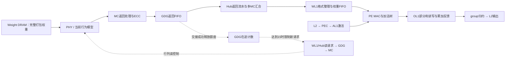
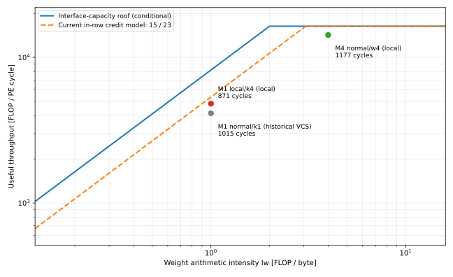
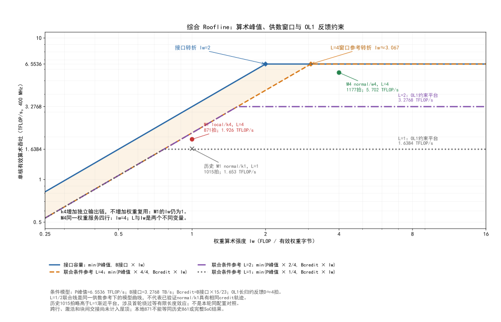
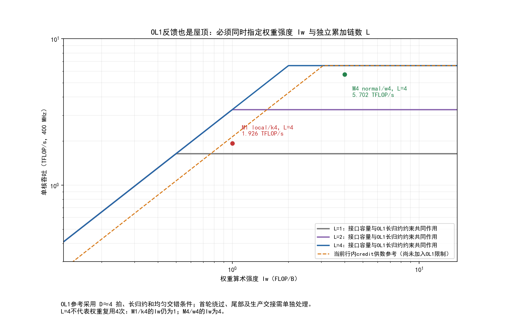
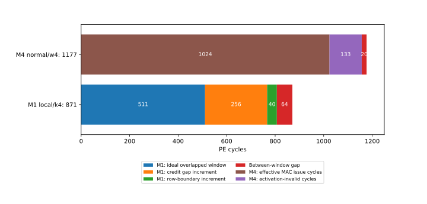

# PE算力、供数与Roofline：基于M1/M4逐周期仿真的统一分析

日期：2026-11-04。对象：Zeus518、稠密BF16输入/权重、FP32输出，完整K4096点积。范围：单核8-group本地RTL台架，以及另外标明的历史VCS结果。软件优化约束：不改生产RTL，保持原归约数值合同。

本文重新组织[原Roofline报告](PE_ROOFLINE_ANALYSIS_20261022.md)及后续跟踪结果。旧报告保留实验历史；当前模型的结论优先以本文及引用的原始产物为准。本文不是新一轮仿真结果，而是对已经完成、可复现的逐拍验证进行归纳。

## 0. 先给结论

1. **当前M1 local/N512/w1/c32/k4的本地871拍，已有可核验的主要因果链。** 理想MAC发射窗口511拍，被32次credit供数空洞延长256拍，被三处MC跨行边界延长40拍，得到807拍；相邻MAC窗口之间另有64拍，形成871拍稳态。64拍尚未完成模块级因果分解。
2. **主要持续供数限制不是接口太窄，而是15笔在途窗口与请求返回寿命不匹配。** 本台架普通行内请求22拍后释放额度，下一拍才能复用；形成典型15笔/23拍的持续请求模式。新日志核验了三块共96处相应边界，不再只是根据总耗时猜测credit瓶颈。
3. **512拍是条件接口下界，不是保证软件可达的性能。** 4 MiB权重÷8192 B/拍=512拍；算术下界256拍。二者充分重叠时取最大值，不能相加。当前请求机制破坏持续满供条件，所以实际大于512。
4. **M1/k4交错四组输出，缓解OL1反馈依赖，却没有增加权重复用。** 每份权重仍只服务一行输入，前一个限制缓解后，持续供数限制更明显。不是k4使权重总量变成原来的四倍。
5. **M4 normal真正复用同一份权重四次。** 本地FIFO分发/弹出计数为4:1，MAC窗口内缺权重为0；1024次有效MAC发射、133拍缺激活、20拍窗口间隔，得到1177拍，算术工作量折算利用率约87%。它没有消除存储链延迟，而是降低了每单位计算对新权重的需求。
6. **M1 normal/k1不能解释为供数没有限制。** 历史约1015拍、单链OL1反馈模型表明消费者本身较慢，供数停顿可能被掩盖。尚未用本轮相同PHY/时钟/插桩台架重跑M1 normal并闭合其credit因果链，不能把“掩盖”写成已逐拍证明的全部原因。
7. **权重可以已经驻留在广义WL1的Weight DRAM中。** 读它仍需WL1专用Hub/GDG unit/MC/PHY路径；不是再绕到另一套外部通用GDG系统。WL1存储体系与PE入口的小块权重FIFO必须分清。
8. **871不是历史861的精确复现。** 本地采用声明的PHY行为模型、单核拓扑和配置；历史simv身份、完整SoC时钟/初始化/竞争环境未完全匹配。不能用“只差10拍”证明二者完全相同。

## 1. 阅读口径：shape、k4、cycles分别是什么

数学计算为：

\[
Y_{M\times N}=A_{M\times K}W_{N\times K}^{T},\quad K=4096.
\]

本文N512指一个完整输出tile的512列，不是整个模型词表大小。M1/M4是真实输入行数；kernel块大小和指令编码另外说明。

| 名称 | 本文含义 | 不能混同 |
|---|---|---|
| 数学K4096 | 每个输出点积的归约长度 | 不等于MTK |
| w1/c32/k4 | 硬件微块的有效MTW/MTC/MTK数量 | 不是split-K四段部分和 |
| MTK有效4 | 四组不同输出的独立累加上下文 | ISA字段通常为数量减一，即3 |
| normal/w4/c16/k1 | 四行输入的执行组织 | 不能仅修改M参数而保留M1全部描述符 |
| cycle | 当前PE参考时钟的一个周期 | 不一定等于所有模块时钟周期 |
| MAC有效拍 | 接收一组有效操作数、推进计算的拍 | 不等于整个流水仅在这拍工作 |
| 稳态间隔 | 相邻完整块完成时刻之差 | 不等于首块启动时间或全算子端到端时间 |

一次乘加按2 FLOPs统计；这是等效算术工作量，不是把每个物理单元都当作原生FMA。本文每拍8192个等效乘加，是全核64个PE的合计，不是单个PE。

## 2. 当前模型究竟模拟了什么

### 2.1 已接入与仍有边界的部分

| 部分 | 当前证据/实现 | 边界 |
|---|---|---|
| WL1指令、索引、地址生成 | 生产RTL；M1三块索引/权重基址和描述符推进 | 不是完整生产程序所有外围调度 |
| Hub返回、GDG请求/返回/credit | 生产模块组成的台架路径 | 不等同完整GDG包装全部功能、双核共享拓扑 |
| MC主要请求/行列控制 | 真实MC相关RTL，采用已校准时序参数 | 不是全部初始化、训练、刷新等运行场景的覆盖 |
| MC内部DW依赖 | 后续已引入原版DW模型的路径 | 不能把更早简化FIFO台架当成本轮 |
| PHY | 根据部署源码实现的同步流水/选通/返回边沿行为模型 | 未运行加密PHY宏，不是模拟电气效应 |
| PEC、AL1、MAC、OL1、L2输出 | 真实计算及控制路径，64个PE检查 | 非完整SoC独立AXI域和多核程序环境 |
| 数据 | 本地诊断数据，数值及请求地址检查 | 不能替代全部生产随机/抵消数据回归 |

本地配置PE/MC均400 MHz；WL1接收域按其生产连线使用PE侧时钟，半周期1250 ps。PHY辅助时钟为2 GHz。不能把另一个NDDG AXI域500 MHz误接到这里；也不能将MC320 MHz作为已确认事实。

### 2.2 最新可复现结果

| 项目 | M1 local/k4 | M4 normal/w4 |
|---|---:|---:|
| 每块shape | [1,4096]×[512,4096]ᵀ | [4,4096]×[512,4096]ᵀ |
| 每块有效权重 | 4 MiB | 4 MiB |
| 每块输出 | 512 FP32 | 2048 FP32 |
| 连续块数 | 3，基址/索引推进 | 3，重复同一完整tile |
| 完成周期 | 1161、2032、2903 | 1817、2994、4171 |
| 稳态间隔 | 871、871 | 1177、1177 |
| 数值检查 | 1536项通过 | 6144项通过 |

M1/M4不是仅有M不同的单因素实验：布局、MTC、索引模式、描述符序列也不同。它们适合解释各自执行路径，不能将所有差异都归给M。

M1本轮新增事件采样后，71469条原有观测记录与未插桩轨迹完全相同，256条lane守恒、64个PE检查均保留。新观测范围是group0/group7各一条Hub0/lane0内部状态，原MAC接口日志覆盖全部group；不能声称新插桩逐个覆盖全部256条通路。

证据：[运行配置](artifacts/credit_events_20261104/status.json)、[无扰动验证](artifacts/credit_events_20261104/verification.json)、[M1/M4同配置复跑](artifacts/firmware_clock_rerun_20261104/comparison.json)。

## 3. 数据在哪里：WL1、GDG、MC、PHY与计算阵列

### 3.1 先消除WL1命名歧义

[存储架构文档](../../lmx_ai_tidy_up_md/2026-08-03-zeus518-storage-and-dataflow.md)把近存储Weight DRAM计入广义WL1；而RTL分析中的“WL1权重整理模块”只描述其中的读控制、格式整理、寄存器和FIFO。两者不是同一个范围。

所以正确说法是：**权重已驻留在WL1对应的Weight DRAM，不代表全部权重已在MAC入口缓冲中。** 计算时仍需逐片读出。GDG是这里使用的访问IP，不是另一份显存；不能把GDG unit的复用解释成必须经外部通用GDG/NoC绕路。



图中实线表示主要返回/计算数据流，虚线表示控制关系；广义WL1存储系统与Verilog实例边界不是一一对应。

### 3.2 生产代码证明这条路径存在

| 代码 | 可直接核对的内容 |
|---|---|
| [wl1_518_hub_mc_wrapper.v](../../rtl/zeus518/wl1/wl1_518_hub_mc_wrapper.v)，约305行 | `gdg_unit wl1_mc_gdg_unit_u0`及其他通路实例 |
| [gdg_unit.v](../../rtl/gdg/gdg_unit/gdg_unit.v)，约461/478/573行 | 返回缓冲、flowctrl、MC/PHY包装实例 |
| [mc_ctrl_phy_wrap.v](../../rtl/gdg/gdg_unit/mc_ctrl_phy_wrap.v)，约184/450行 | `mc_subsys_top`及非FPGA分支的`hb_macro_bnk_230m_4s_sample` |
| [gdg_rdata_buffer.v](../../rtl/gdg/gdg_unit/gdg_rdata_buffer.v)，约37行 | 返回valid/ready释放事件、16项返回FIFO |
| [wl1_518_weight_data_format.v](../../rtl/zeus518/wl1/wl1_518_weight_data_format.v)，约1130行 | MTW复用期间保留权重，到计数末尾才弹出FIFO |

MC/PHY之间有行地址、列地址、CAS读使能、返回数据和返回时序信号。生产存在该路径，不代表本地行为模型已经与所有PHY配置时序完全一致。

## 4. 第一层Roofline：接口容量，不含持续服务限制

### 4.1 算术容量

\[
P_{peak}=8192\ \mathrm{MAC/PE\ cycle}\times2
=16384\ \mathrm{FLOP/PE\ cycle}.
\]

400 MHz下为6.5536 TFLOP/s，单核口径。

每块算术工作量：

\[
F=2MNK=2M\times512\times4096.
\]

M1为4194304 FLOPs，算术下界256拍；M4为16777216 FLOPs，算术下界1024拍。

### 4.2 权重接口容量

当前双Hub配置下，每group两个4096-bit返回接口：

\[
B_0=8\ \mathrm{groups}\times2\ \mathrm{hubs}\times4096/8
=8192\ \mathrm{B/PE\ cycle}.
\]

也可以按256条lane、每笔32B理解：256×32=8192B。全阵列一次有效操作数所需权重16 KiB，理想接口需两拍提供；每group的16个MC片段先汇合，再由WL1整理给PE。各通路持续齐备、时钟口径和无额外等待都是容量计算的条件。

\[
Q_w=NK\times2=4194304\ \mathrm B=4\ \mathrm{MiB},\quad T_w=Q_w/B_0=512.
\]

充分重叠时：

\[
T\ge\max(F/P_{peak},Q_w/B_0).
\]

M1取max(256,512)=512；M4取max(1024,512)=1024。不能使用512+256或512+1024。

### 4.3 权重算术强度

\[
I_w=F/Q_w=M\ \mathrm{FLOP/B},\quad
P\le\min(P_{peak},B_0I_w).
\]

这是只考虑权重的分层Roofline，未将激活、输出、索引及其他存储层流量一并纳入。容量交点为2 FLOP/B。k4只改变执行组织，不把M1的I_w从1提高到4；M4真实复用权重才使I_w=4。

## 5. 第二层Roofline：为什么宽接口仍可能供不满

### 5.1 请求窗口相当于有限数量的运输车

接口宽度像道路可容纳的流量；返回延迟像一辆车完成运输所需的时间；credit窗口像可同时派出的车数。车尚未完成返回交接，不能用同一个名额再派下一辆。这里没有“释放权重地址”的操作，权重仍保存在原地址。

生产RTL中：

```verilog
// gdg_rdata_buffer.v
asyn_fifo_boreg #(.DW(256+2), .AW(4), .PN(2)) u_rdata_fifo_boreg (...);
assign rdata_buffer_received = rdata_buffer_rvalid && rdata_buffer_rready;

// gdg_flowctrl.v
reg [4:0] rdata_outstanding;
// 请求增加、返回被接收则减少；同时发生则不变
assign flow_ctrl_halt = (rdata_outstanding >= 5'd15) || ...;

// gdg_axi2frame.v
assign rr_ready = !frame_fifo_full & !flow_ctrl_halt;
```

FIFO深度为2^4=16项；限流阈值15是独立的固定RTL常量；5位计数器能表示31不代表允许31笔。在当前源码中没有编译器或ISA可设置这些数的接口。扩大窗口需联动返回容量、相关FIFO和协议验证，不可只删掉halt。

### 5.2 同一笔请求的22拍与23拍

以lane0地址143、第一行col15为例：

| 周期 | 事件 | 与上一步的差 |
|---:|---|---:|
| 291 | GDG接受读请求 | 起点 |
| 293 | MC接受请求 | 2 |
| 295 | 发CAS读命令 | 2 |
| 310 | 对应ECC有效事件 | 15 |
| 313 | GDG返回FIFO向Hub侧交接，释放额度 | 3 |
| 314 | 计数更新后，该额度可支持新请求 | 1 |

因此请求到释放为2+2+15+3=22拍；可复用的请求循环为23拍。对应PHY返回事件为`PHY_RETURN ps=774750 addr=143`，在核心周期304/305之间。中间15拍包含PHY模型、MC返回采集/跨域和ECC，尚未全部细分成独立内部阶段；不能说成PHY单独15拍。

日志中的另一个23是“第二笔权重CAS→MAC有效”的传播差，它不等于credit寿命，即使数值恰好相同也不能混用。

### 5.3 所有请求并非都22拍

lane0三块共1539笔，含1536笔权重和3笔索引。请求/释放按序配对的寿命分布：

| 寿命 | 笔数 |
|---:|---:|
| 22 | 1356 |
| 27 | 48 |
| 28 | 24 |
| 29 | 1 |
| 35 | 110 |

开行、跨行等请求寿命更长。不能用22覆盖全部请求，更不能用一个平均寿命直接替代逐拍推导。证据：[analysis.json](artifacts/credit_events_20261104/analysis.json)、[计数CSV](artifacts/credit_events_20261104/lane_g0.csv)。

### 5.4 从窗口到条件持续带宽

对普通行内满需求情况，15笔/23拍循环实测成立：

\[
B_{credit}\approx B_0\frac{15}{23}=5342.61\ \mathrm{B/PE\ cycle}
=5.217\ \mathrm{KiB/PE\ cycle}.
\]

400 MHz下约为2.137 TB/s权重带宽：5342.61×400×10^6=2.137×10^12 B/s。

这一行内服务模型对应：

\[
P\le\min(16384,5342.61 I_w),\quad I_{ridge}\approx3.067\ \mathrm{FLOP/B}.
\]

这是声明配置下的行内持续参考线，不是用全算子时间拟合出来的通用屋顶，也不是所有布局/频率下的物理上限。跨行、启动和有限tile会改变整体平均；不能对4MiB/871的实测值再乘一次15/23。



图中历史M1 normal点是单独标注的VCS参考，不属于本轮同配置插桩点。M1/M4点的横坐标只计有效权重流量。

### 5.5 综合Roofline：供数与OL1反馈共同约束（400 MHz）



[PNG版本](artifacts/pe_roofline_cycle_20261104/roofline_layered_current.png) · [可复现绘图脚本](artifacts/pe_roofline_cycle_20261104/plot_layered.py)

| 图中对象 | 数学含义 | 适用边界 |
|---|---|---|
| 蓝线：接口容量 | min(6.5536, 3.2768×Iw) TFLOP/s | 权重通路持续满供、单核400 MHz的条件容量 |
| 橙虚线：L=4联合参考 | min(6.5536, 2.1370×Iw) TFLOP/s | 四条有效交错链可隐藏约4拍反馈；供数采用本地行内15笔/23拍循环 |
| 紫点划线：L=2联合参考 | min(3.2768, 2.1370×Iw) TFLOP/s | 同一供数假设下的双链长归约模型，非新增实测 |
| 灰点线：L=1联合参考 | min(1.6384, 2.1370×Iw) TFLOP/s | 同一供数假设下的单链长归约模型；未验证normal具有相同credit轨迹 |
| 两线间浅色区域 | 当前窗口机制相对原始接口容量的差距 | 不能将整块周期差全部归于此区域 |
| 红点：M1 local/k4 | Iw=1，4194304/871×400MHz≈1.926 TFLOP/s | 包含跨行与块间交接后的有效吞吐 |
| 绿点：M4 normal/w4 | Iw=4，16777216/1177×400MHz≈5.702 TFLOP/s | 权重复用4次；仍有激活无效和交接周期 |
| 灰点：历史M1 normal/k1 | Iw=1，4194304/1015×400MHz≈1.653 TFLOP/s | 历史VCS参考，不是本轮同配置插桩结果 |

读图方式：先根据真实权重复用确定横坐标Iw，再根据实际交错的独立累加链数L选择联合曲线；该曲线同时取算术、供数与OL1反馈容量中的最低值。M1/k4仍位于Iw=1，增加输出组没有将点移到Iw=4；M4的跨行权重复用才使它移到右侧。窗口约束把参考转折点从2推到约3.067 FLOP/B，因此M1更容易受供数限制，M4则有条件接近算术平台。

本地实测点低于L=4参考线并不矛盾：曲线尚未计入有限tile的跨行、指令交接和激活缺口。历史normal的1015点略高于L=1长归约平台，须考虑首轮绕过等有限长度效应：局部有限长度模型为1015，长归约近似为1024；不可把渐近参考线当作有限tile严格上界。没有用实测4MiB/871反向画一条“新的通用带宽线”，避免循环论证。M1 normal与local的点差也不能被直接解释为单一因素的净收益，需保留配置与证据差异。

### 5.6 OL1反馈屋顶：供数之外仍有“旧部分和是否可用”的约束

**OL1仍是独立约束。第5.5节综合图现已加入L=1/2/4联合曲线，本节展开其反馈机制、数学条件与代码依据。** 下方OL1分解图保留接口容量条件，用来区分OL1本身与credit供数降额的作用。

#### 从一次累加看等待在哪里

对于同一个输出，沿归约方向逐次计算：

```text
本次MAC片段部分和 + OL1中的旧部分和
                  ↓
             FP32累加流水
                  ↓
        写回OL1，更新旧部分和可用状态
                  ↓
        下一次依赖该输出的累加才能继续
```

OL1保存的是**输出部分和**，不是权重。对同一个输出，下一次累加必须使用上一次的新结果；三级加法流水能接收其他独立输出，却不能跳过这种数据依赖。

当前RTL局部模型中，三级FP32累加加上寄存可用状态，得到同一链约4拍的反馈间隔。`pe518_ol1.v`中的`fp32_sum`和控制流水是对齐关系，不应相加为六级。`pe518_ol1_wrctrl.v`中的`wr_one_mtc`、`rd_one_mtc`更新`avlb_mtc_cnt`，再驱动寄存的`acc_rd_en`；`acc_rd_hs = i_acc_rdy & acc_rd_en`决定旧和读取。可用性不足能经计算流水反压上游。

代码依据：[OL1运算路径](../../rtl/zeus518/pegroup/pe518_ol1.v)、[OL1控制](../../rtl/zeus518/pegroup/pe518_ol1_ctrl.v)、[部分和可用状态](../../rtl/zeus518/pegroup/pe518_ol1_wrctrl.v)。完整旧模型及跨shape比较见[旧报告第13节](PE_ROOFLINE_ANALYSIS_20261022.md#13-代入实际-isa-后的-ol1-反馈节拍推导2026-10-22补充)。

这里的OL1可用状态与GDG的15笔请求credit是**两种不同资源**：前者等待旧输出部分和写回，后者等待权重读响应被接收，不能合并为一个计数器或一段等待。

#### 独立链数决定能否隐藏反馈

设有效独立累加链数为 \(L\)，同一链的反馈间隔为 \(D\approx4\) 拍。在长归约、均匀交错、操作数与输出都就绪的条件下：

\[
P_{OL1}(L)\approx P_{peak}\min(1,L/D).
\]

因此完整的长流容量参考应写成：

\[
P\lesssim\min\left(P_{peak},\ B_{eff}I_w,\ P_{OL1}(L)\right).
\]

其中 \(B_{eff}\) 可用接口容量或本地行内credit模型作条件参考；仍不包含跨行和有限tile交接。等价的时间参照是取各项下界的**最大值**，不是将OL1等待、权重传输和计算周期直接相加。

| 执行组织 | 有效独立链L（局部模型） | 理想交错示意 | OL1长归约参考容量 | 权重强度Iw |
|---|---:|---|---:|---:|
| M1 normal/w1/k1 | 1 | 链0：0、4、8……拍 | 峰值的1/4 | 1 |
| 两条有效独立链 | 2 | 链0/1：0、1、4、5……拍 | 峰值的1/2 | 不能由L单独确定 |
| M1 local/w1/k4 | 4 | 输出组0/1/2/3交错 | 可到峰值 | 仍为1 |
| M4 normal/w4/k1 | 4 | 输入行0/1/2/3交错 | 可到峰值 | 4 |

**L是执行过程中实际交错的独立输出上下文数，不是缓冲槽位数，也不是只读一个MTK字段就能确定的性能。** normal布局直接增加MTK曾退化，说明供数顺序也必须配合。



图中L=1/2/4曲线采用接口容量，与OL1长归约模型共同取最小值；橙线单列当前credit供数参考。当前local/k4和M4均有四条有效交错链，但前者Iw=1，后者Iw=4，因而不会得到同样的算力利用率。

单链长归约模型的M1时间参考为256×4=1024拍。历史有限长度OL1模型考虑首轮不读旧和及尾部后为1015拍；**1015略小于1024不是超过硬件能力，而是长归约近似与有限长度边界的差别**。这也是此图不将历史1015点当成严格落在单链渐近屋顶下的原因。

#### 为什么本轮871不能再全部归因于OL1

当前local/k4台架已经包含真实AL1/MAC/OL1路径，ready由计算端产生。本轮32处10拍间隔有请求credit耗尽、请求恢复、CAS与MAC事件的对应证据；不能把这些已追踪到的间隔改称为单链OL1等待。四链交错缓解了反馈约束，但并未提高每份权重的复用次数，因此持续的新权重需求暴露了供数窗口限制。

这不等于“OL1无任何影响”：计算端反压、输出排空、ping/pong切换及块间交接仍属于完整执行路径。块间64拍尚不能全部归给OL1；M4记录到的133拍激活无效也不能未经进一步因果追踪就全部称为OL1等待。

对M1 normal，现有单链反馈结构和历史1015匹配是强证据，但仍缺本轮配置下的配对事件日志，不能声称已逐拍证明其所有等待。**normal的反馈限制较强；local/k4缓解反馈后受持续供数约束；M4同时具备多链交错与权重复用，因而更接近算术峰值。** 三者必须用不同的 \((I_w,L)\) 解释，而不能只看M或只看带宽。

## 6. M1 local/k4：从请求停发到871拍

### 6.1 第一处空洞的因果链

| 周期 | 观测事实 |
|---|---|
| 255–269 | 连续接收15笔权重请求 |
| 270开始 | outstanding=15，halt=1，禁止新请求进入 |
| 285 | 请求FIFO已空，旧CAS仍在流水中 |
| 286 | col14发CAS |
| 287–294 | 没有CAS，MC ready仍为1；此处不是MC正在换行 |
| 290 | 首笔权重返回交接，释放额度 |
| 291 | 计数14，恢复接收请求 |
| 293 | 新请求被MC接收 |
| 295 | col15发CAS，距col14为9拍 |
| 308→318 | MAC先等到col13对应的第二半，再等col15；有效发射间隔10拍 |

col14提前到达也不能独立完成下一次全操作数发射，需要配对的col15。下游没有数据时，空着的缓冲不能凭空提供权重。

第一次开行中，270开始的停发较长，但已有请求/返回流水会遮住一部分；不能将全部halt周期直接计入MAC停顿。更典型的一轮是291–305发15笔，306–313停止，314恢复，恰为23拍循环。

### 6.2 为什么恰有32处10拍间隔

每lane每块512笔，当前物理行每行128笔，共4行。普通行内的空洞在列15、30、45、60、75、90、105、120前出现，每行8处。

\[
N_{gap}=4\times8=32,\quad \Delta T_{credit}=32(10-2)=256.
\]

15笔窗口是奇数，两笔构成一次MAC操作数，因而MAC边界序号呈7、15、22、30等交替。不要把这些边界解释为四个MTK输出组的交接。脚本核验了三块共96处恢复额度、恢复请求、9拍CAS间隔与10拍MAC间隔的对应关系。

### 6.3 另外三处15/16/15拍间隔

每128笔跨物理行，两笔/MAC，因此每64次MAC发生一次行边界。256次MAC内部有三处：

| MAC边界 | 旧行最后CAS | 预充电开始 | 新行第二笔CAS | MAC前→后 | 间隔 |
|---|---:|---:|---:|---|---:|
| 64→65 | 463 | 463 | 478 | 486→501 | 15 |
| 128→129 | 668 | 669 | 684 | 691→707 | 16 |
| 192→193 | 874 | 874 | 889 | 897→912 | 15 |

MC真实状态机执行关旧行、等待、新行激活等过程。中央边界同时出现WL1的C地址切换气泡：661拍`tcchange/ADDR_CNT_DELAY_FLAG`使请求暂停，而请求ready为1；气泡传到MC，使预充电晚一拍。相对正常2拍的增量为13+14+13=40。

依据：[边界报告及九个CSV](PE_BOUNDARY_CAUSAL_ROOFLINE_20261104.md)；[WL1地址生成控制](../../rtl/zeus518/wl1/wl1_518_weight_ctrl.v)约1359行；[MC frame2array状态机](../../Zeus518/IP/ZGGX/MC_2025_09_12/rtl/mc/frame2array_aux.v)约400–494行。中央一拍尚未通过消除气泡的反事实修改证明可安全移除。

### 6.4 807与871的完整数学账目

256次MAC发射之间有255个间隔：220个2拍、32个10拍、2个15拍、1个16拍。

\[
T_{window}=1+220\times2+32\times10+2\times15+16=807.
\]

其中1表示首个发射拍；这是含首尾的时间窗口。改写为：

\[
T_{window}=\underbrace{1+255\times2}_{511\text{，理想重叠发射窗口}}
+\underbrace{32\times8}_{256\text{，credit空洞增量}}
+\underbrace{2\times13+14}_{40\text{，跨行增量}}.
\]

511与512差一拍来自测量起止不同：511从第一次MAC发射到最后一次发射计含首尾；512是供齐全部512笔权重的理想流量预算，不能随意交换两个端点。

第一块MAC窗口296–1102；下一块从1167开始。中间1103–1166共64拍。因此：

\[
T_{steady}=807+64=871.
\]

也可核对最后MAC1102→完成1161→下块首MAC1167：`806+59+6=871`。这里806是首末事件差，不含首拍；不能写807+59+6。

把窗口分成256个有效发射拍和551个未发射拍也成立，但这是互斥时间分类，**不是256拍计算加551拍独立搬运**。未发射时其他流水仍可工作，已发射拍也可同时读取后续权重。



两条柱子的分项口径不同：M1是理想重叠窗口加增量；M4是有效发射拍加未发射拍。它们都是可加的时间分割，不代表各硬件模块独占的运行时间。

## 7. 为什么M1 normal、M1/k4、M4 normal表现不同

### 7.1 独立累加链与权重复用是两件事

M1/k4的示意：

```
A0 × 输出组0的权重 → Y0组0
A0 × 输出组1的权重 → Y0组1
A0 × 输出组2的权重 → Y0组2
A0 × 输出组3的权重 → Y0组3
```

不同输出可交错累加，避免总等同一个OL1地址，但每次需要不同的新权重。四个输出组是当前N512工作量的内部划分，合计仍4 MiB，K4096归约没有变成四段并行部分和。

M4/w4的示意：

```
A0 × 同一份W片段 → Y0
A1 × 同一份W片段 → Y1
A2 × 同一份W片段 → Y2
A3 × 同一份W片段 → Y3
```

四行产生四套独立输出；同一权重留在FIFO中服务四次后才弹出。真正减少的是每单位FLOP所需的新权重流量，而不是声称M4总权重只有M1的四分之一。

### 7.2 M1 normal/k1：消费者慢，不能据此说存储快

历史normal/k1稳态约1015。旧分析从OL1三级FP32累加和寄存可用计数推导单链约每4拍才可再次接受依赖累加，相关RTL见[pe518_ol1_wrctrl.v](../../rtl/zeus518/pegroup/pe518_ol1_wrctrl.v)及[旧报告第13节](PE_ROOFLINE_ANALYSIS_20261022.md)。

直观上：只更新同一个输出部分和，下一次需要前一次写回的结果。即使更多权重到达，也不能立即消费；因此供数链有更多时间补数据。用平均需求估算，完整16 KiB新权重若每约4拍消费一次，需求约4096 B/拍，低于当前行内窗口服务估计5343 B/拍；这解释了供数不足可能不成为最显著的限制。

**但这只是结合已知反馈结构的机制解释。** normal/k1的布局和请求组织不同，不能直接套用local/k4的全部22拍与15/23轨迹；本轮没有相同配置下的M1 normal逐拍信用链对照。1015不是“没有问题”，它比871更慢，是另一项限制可能更早起作用。

历史固定normal布局只把k1改k2/k4，曾退化到4864；联合local V-cache才得到1051/897/861（k1/k2/k4）。说明独立链数量必须与数据布局和请求遍历匹配，不能只调MTK。

### 7.3 M1 local/k4：反馈约束缓解，供数需求升高

数学工作量和权重总量未变，但原本被OL1等待限制的发射机会增多。当前理想供数下仍只能平均两拍一次全阵列发射；请求窗口进一步把这一节拍打断。就像修好了下游的窄路后，开始看到上游车辆数量不足：不是优化制造了四倍权重，而是暴露了另一条原有约束。

本轮MAC窗口内激活和其他已记录接收条件满足，权重有效存在空洞；新增credit日志将其中256拍增量追到上游请求窗口。这个结论比“WL1带宽利用率低”更具体。

### 7.4 M4 normal：为什么相同返回链不再限制MAC

本地三块每group分发3072次、权重FIFO弹出768次，精确4:1；对应`weight_fifo_rd_en`仅在MTW计数末尾才置位。相同4 MiB权重支持四倍算术工作。

全阵列每份16 KiB权重可以支持4个有效MAC发射拍，因此满算术需求的新权重平均速率是：

\[
B_{need,M4}=16384\ \mathrm B/4=4096\ \mathrm{B/拍},
\]

低于当前行内窗口服务估计5343 B/拍；预取/缓冲与复用可以掩盖部分请求停顿。这个需求比较只是解释条件，真正的支持证据是本地MAC窗口**缺权重拍数为0**，并且调整PHY返回模型后M4仍1177。

M4仍有未发射拍：

\[
T_{window,M4}=1+1016\times1+7\times20=1157
=1024+133;
\]

\[
T_{steady,M4}=1157+20=1177.
\]

133拍对应激活无效，不应未经继续追踪就称为某个AL1模块固有延迟。M4并非“完全没有限制”，而是主要可见限制不同。

**credit的halt为1不必然意味着MAC受限。** M4也会达到15笔、暂停预取，但消费者正在复用手中权重；只看halt累计值会误判。必须检查停发是否传播到MAC所需数据的缺口。

### 7.5 三者汇总

| 项目 | M1 normal/k1 | M1 local/k4 | M4 normal/w4 |
|---|---|---|---|
| 权重服务行数 | 1 | 1 | 4 |
| 输出独立上下文 | 单链反馈突出 | 四组输出交错 | 四行交错 |
| 权重算术强度 | 1 | 1 | 4 |
| 当前代表时间 | 历史1015 | 本地871；历史861 | 本地1177 |
| 最有力的机制证据 | OL1反馈RTL/历史模型 | 请求窗口→CAS→MAC逐拍链 | FIFO复用4:1、窗口缺权重0 |
| 不可下的结论 | normal无供数限制 | k4自动获得四倍复用 | M4证明PHY模型与真实硬件完全一致 |

## 8. 哪些因素影响供数，如何判断是不是瓶颈

| 因素 | 为什么影响供数 | 当前证据/状态 |
|---|---|---|
| 接口宽度与有效时钟 | 决定每单位时间能传多少字节 | 8192B/PE拍是条件容量；异频不能直接按同拍相加 |
| 权重布局/请求次序 | 改变地址、局部连续性、汇合及重用方式 | normal改变MTK曾退化；local联合调整有收益 |
| 在途窗口与返回寿命 | 等额度使请求停发，随后返回流出现空洞 | 本地96处边界闭合，普通22拍寿命/下一拍复用 |
| MC物理行切换 | 关行/开行/时序等待使读命令不连续 | 每块三处长间隔，40拍增量 |
| WL1地址生成控制 | 某些计数切换拍主动不发请求 | 中央C切换对应多1拍；不是所有地址跳转都耗1拍 |
| 返回FIFO与下游ready | 缓冲不足或消费者慢会阻止返回交接、延迟credit释放 | Hub0代表lane没有返回反压；全256路有128路累计3拍，不能说全局零反压 |
| 多MC汇合 | 片段未齐，完整操作数不能交付 | 结构存在；不能仅据结构认定它是当前主因 |
| 权重复用 | 同一返回数据支持更多计算，降低新数据需求 | M4分发/弹出4:1；M1/k4没有同等复用 |
| AL1供应与OL1反馈 | 计算端不接收也会向供数端传播反压 | M4窗口缺激活133拍；normal/k1反馈模型 |
| 指令/索引/输出交接 | 改变启动、收尾、连续块预取重叠 | M1窗口间64拍未完整归因，不应全部称固定开销 |
| 多核、完整SoC、版本 | 共享点/配置可能不同 | 本文未完整模拟，不用于填补861与871差值 |

返回链中的很多阶段重叠。不能将各级stall计数相加，也不能把所有lane计数相加当作单核耗时。瓶颈证据至少需要“触发条件→被阻止的事件→必要数据缺口→关键路径延长”四步。

## 9. 性能数字如何使用

| 量 | M1 local/k4 | M4 normal/w4 |
|---|---:|---:|
| 完整块周期 | 871 | 1177 |
| 有效权重吞吐Qw/T | 4815.5 B/拍 | 3563.6 B/拍 |
| 相对8192B/拍容量 | 58.78% | 43.50% |
| 有效算术F/T | 4815.5 FLOP/拍 | 14254.2 FLOP/拍 |
| 相对算术峰值 | 29.39% | 87.00% |

M4权重吞吐更低、算术利用率更高完全正常，因为一个权重服务四行。上述利用率是工作量除以时间/容量，不是物理总线busy计数或所有ALU晶体管的活动率。

用窗口参考带宽估算M1：4MiB/5342.61≈785.07拍。这只是充分长普通行内的预算，不能以785.07与871之差认定某个模块的等待。准确871来自第6节事件账目。对于M4，算术下界1024拍已高于这个供数预算，所以它可以在存储窗口并非满接口效率时仍表现为算术更接近限制。

## 10. 跟踪历史：哪些结论被保留，哪些被修正

| 阶段 | 得到了什么 | 当前应如何理解 |
|---|---|---|
| 初始容量推导与normal实测 | 256计算下界、512权重下界、1015实测 | 512不是完整模型预测；1015不能拆为独立计算+搬运 |
| OL1反馈分析、布局/MTK对照 | 单链反馈解释；local/k4历史降到861 | 解决一项约束，不保证达到接口上界 |
| 理想供数/真实计算逐步接入 | 检验AL1/MAC/OL1、控制与返回链 | 理想边界是有意简化，不能当成已复现生产环境 |
| MC时序、DW、索引/描述符校准 | 排除部分人为模型差异 | 不同版本570、607等结果不可与871混称同一配置 |
| 部署PHY行为修订受控对照 | M1由607变871，M4仍1177 | 唯一受控修改是返回机制整体，不能分别量化内部每个改动贡献 |
| 跨行事件关联 | 15/16/15对应MC行切换、中央地址气泡 | 40拍窗口增量解释；不是整个剩余差距 |
| 新增credit只读事件并重跑 | 96处窗口→CAS→MAC链、轨迹不变 | 当前本地持续限制已具直接证据，不再仅是候选假设 |

这条历史也说明为什么不能说“之前全白做”：早期台架逐项确立了哪些模块在理想条件下能满足节拍；但当时未匹配的返回机制确实会影响结论，不能把早期局部PASS扩大为整机性能证明。

## 11. 优化方向、预期与不能承诺的收益

### 11.1 不改RTL时

- **保留正确的布局与MTK联合选择。** M1 local/k4已经有历史VCS收益，不能因窗口存在就退回固定normal提高MTK。继续修改必须验证最终描述符、物理权重和归约语义。
- **业务允许时合并真实输入行。** M4复用可提高吞吐，但这是批处理收益，不是单行延迟无代价改善；复制相同输入制造M4不增加有用工作量。
- **检查连续块交接与合法提前请求。** 64拍尚未分解，是下一项具体可查范围；不能承诺编译器能消除它，且预发也不能绕过固定credit阈值。
- **减少实际权重流量的方案需要单列合同。** 量化、稀疏、压缩若被硬件支持可能改变强度，但不属于保持当前BF16逐位结果的免费优化。
- **扩大N只摊薄部分边界。** 历史N1024/k8有有限收益；权重和计算工作同比增加，15笔窗口仍在，不能期望单靠tile增大获得接近2倍提速。

### 11.2 如果未来允许硬件实验

缩短返回链寿命，或联动扩大安全在途窗口及返回缓冲，可用于验证机制和探索上限。不能只将15改成23/31；返回不能任意被暂停，须检查所有缓冲、跨域、保序、溢出和极端反压。

孤立预算“32处10拍全部变2拍”给出871−256=615；这不是已实现收益，也不能保证其它边界保持不变。即便如此仍包含跨行40和块间64，不能自动声称做到512。

### 11.3 下一步最有信息量的验证

1. 在同一最新配置补M1 normal/k1的配对插桩，核验OL1反馈与credit空洞到底怎样重叠。避免用本地local日志解释历史normal的每一拍。
2. 对M1的最后MAC→完成→下一块首MAC记录指令、索引、权重首到、输出接受事件，分解64拍。
3. 若需要继续缩短22拍，增加MC内部返回FIFO、ECC前后时间戳，细分CAS→ECC的15拍；先定位，再讨论能否软件改变。
4. 只有需要声称生产861根因一致时，再匹配实际simv/固件/时钟/编译宏和双核配置；本文不以调参拟合861为目标。

## 12. 证据目录与复现说明

| 产物 | 用途 |
|---|---|
| [credit报告](PE_CREDIT_EVENT_CAUSAL_RESULTS_20261104.md) | 本地限流因果链 |
| [build.py](artifacts/credit_events_20261104/build.py)、[run.py](artifacts/credit_events_20261104/run.py) | 只读驱动构建及原参数重跑；依赖原生成RTL对象归档 |
| [analyze.py](artifacts/credit_events_20261104/analyze.py)、[verify.py](artifacts/credit_events_20261104/verify.py) | 计数递推/96处边界断言、原轨迹比较 |
| [完整日志](artifacts/credit_events_20261104/run.log)、[边界JSON](artifacts/credit_events_20261104/credit_boundaries.json) | 可按周期/事务序号核查 |
| [跨行报告](PE_BOUNDARY_CAUSAL_ROOFLINE_20261104.md) | 三次行边界及中央地址气泡 |
| [时钟/PHY历次复跑](PE_DESIGN_DOC_CLOCK_REPLAY_20261103.md) | 模型差异、M1/M4成对运行与证据边界 |
| [早期M4对照](PE_M4_NORMAL_X8_COMPARISON_20261103.md) | normal描述符及MTW复用证据；其中早期M1时间已被后续模型更新 |
| [绘图脚本](artifacts/pe_roofline_cycle_20261104/plot.py)、[数字表](artifacts/pe_roofline_cycle_20261104/numbers.json) | 本文两图的可复现来源 |

读日志时注意：优化后的Verilator部分端口副本不会持续更新。本轮使用真实SV累计计数的相邻差值以及有效内部状态核对握手，不拿恒零副本作无请求证据。字段、时钟、端点不明确时，不能只凭一个数字给模块归因。

本文已经展开完整分析，剩余空白是明确列出的验证边界，而不是等待补写的结论。
